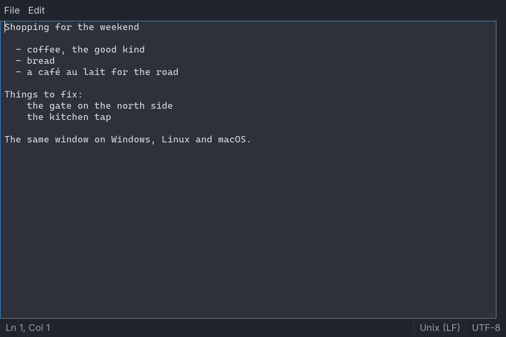

# Capstone: a Cross-Platform Notepad

The other capstones run in a terminal. This one has windows. **`tpad`** is a plain-text editor in
the shape of the Notepad that comes with an operating system: a menu bar, a page of text, a status
bar, the usual keys, and a question before it throws away unsaved work.

It is built on **tkControls**, the vendor package of controls that draw into SDL3 windows, and
**one source builds and runs on Windows, Linux and macOS**. Much of it is about text files rather
than windows, and most of what is interesting about the windows is the short list of things that
differ from one system to the next: a file dialog that does not stop your code, a text control that
counts in bytes, a command key that is not always Ctrl, and a Quit that arrives from the system and
never touches your window. It joins:

- modules and a package (Chapter 15), with the part that needs no window kept apart from the part
  that does;
- procedure pointers and lambdas (Chapters 7 and 21), which is how every control reports back;
- `new` and `delete` for state that lives as long as a window (Chapter 11);
- files, text encodings and atomic writes through `std/fs` (Chapters 9 and 25);
- text as units and as bytes (Chapter 9);
- a C library's callback, and the thread it may arrive on (Chapters 23 and 30);
- conditional compilation by platform (Chapter 16);
- `tiko build`, and what a program built on shared libraries takes with it (Chapter 31).



## The specification

```text
tpad [file]
tpad --selftest
tpad --shot out.bmp [file]
```

- **One window**: a menu bar, the text, a vertical scroll bar beside it, and a status bar.
- **It runs on Windows, Linux and macOS**, from one source with no per-platform files.
- **File**: New (Ctrl+N), Open (Ctrl+O), Save (Ctrl+S), Save As (Ctrl+Shift+S), Exit. **Edit**: Undo,
  Cut, Copy, Paste and Select All, on their usual keys; Find (Ctrl+F) and Find Next (F3).
- **The command key is Cmd on macOS** and Ctrl elsewhere, for `tpad`'s own keys and the text box's,
  and the menus say which.
- **Text is UTF-8.** A file keeps the line ending it was written with, CR LF or LF, and its
  byte-order mark if it had one, when it is saved. A file with no line break is saved with CR LF.
  A file that is not UTF-8 opens with U+FFFD in place of what could not be read, and `tpad` says
  so. Selection, Find and the line and column are right after accented letters and other
  characters that are not ASCII.
- **The status bar** shows the caret's line and column, the line ending, and the encoding.
- **The title bar** shows the file's name, with a `*` in front while there are unsaved changes.
- **Before anything throws away unsaved text** — New, Open, closing the window, or the system's own
  Quit, such as Cmd+Q on a Mac or a logout — `tpad` asks: Save, Don't Save, or Cancel.
- **Find** ignores case unless asked not to, and wraps around from the end to the top.
- **`--selftest`** drives the window with nobody at it, prints what happened, and exits.
- **`--shot`** renders the window once and saves it as a picture, so that two systems can be
  compared.

## The layout

```text
ch36/
    tiko.toml               the package, and the target tpad
    textfile/textfile.tiko  the document: load, save, find, line and column
    filetest.tiko           textfile on its own, on every target
    offsets/offsets.tiko    UTF-8 bytes and ustring units
    offsettest.tiko         offsets on its own, on every target
    pad/pad.tiko            the window: controls, menus, commands
    tpad.tiko               the program, and its self-test
```

The rule is the one from Chapter 33: **the part that does not need a window does not import one.**
Everything `tpad` knows about text files is in `textfile`, which imports `std/fs` and
`std/strings` and nothing from tkControls, and `offsets` imports nothing at all. Each is tested by
a program that prints. `pad` is the window, and `tpad.tiko` starts it.

```toml
{{#include ../examples/ch36/tiko.toml}}
```

That is the whole manifest, and nothing in it names a platform.

## The document

```tiko
{{#include ../examples/ch36/textfile/textfile.tiko:head}}
```

```tiko
{{#include ../examples/ch36/textfile/textfile.tiko:model}}
```

A `Document` is what was read from the file, and what is needed to write it back the same way:
its path, its text, its line ending, and whether it began with a byte-order mark. `lossy` records
that some of its bytes could not be read. (The module is `textfile` and not `document` because a
module may not export a name it shares, in any case, with its own:
`TKO0870: public 'document' has the same name as its module 'document'`.)

The comment on `text` is the most important line in the module. **Inside a `Document`, a line
break is one character, LF.** Files do not agree on that, so the module converts at the edge.
`ToLf` makes it true of any text, whatever its line breaks:

```tiko
{{#include ../examples/ch36/textfile/textfile.tiko:tolf}}
```

A multiline `tkTextBox` keeps its text the same way: it turns a CR LF that is set or pasted into
LF. A line break is one in the document and one in the box, so lines and line breaks agree between
the two. Other characters are a different story, and a later section is about it.

### Loading

```tiko
{{#include ../examples/ch36/textfile/textfile.tiko:load}}
```

`fs.ReadAllText` does most of the work, and two things it does decide the rest of the function:

- **It removes a byte-order mark**, UTF-8's or UTF-16's, and decodes what follows. That is what a
  program reading text wants, but an editor must write the mark back, so `StartsWithBom` opens the
  file and reads its first three bytes itself.
- **It replaces bytes that are not UTF-8 with U+FFFD**, the replacement character, on every
  target. A file in an old 8-bit encoding opens, but its accented letters are gone from the
  text, and saving writes the replacement characters. `Load` records that in `lossy`, and the
  window warns before anyone edits the file.

The line ending is the file's first one: an LF with a CR before it means CR LF. A file that mixes
the two is saved with the first kind throughout. `Load` fills a local `Document` and copies it to
`doc` only when everything has worked, so a failed open leaves the document that was there.

````admonish danger title="Pitfall"
`fs.ReadAllBytes` has a three-argument form, and it is not "read the first *n* bytes". The third
argument is a **limit**: a file larger than it is refused with an error, and nothing is read.

```tiko
fs.ReadAllBytes( p, head, 3 )    '' fails on any file over 3 bytes
```

The first draft of `StartsWithBom` was that line. It compiled, every file was "too large", the
function returned `false`, and the byte-order mark was quietly dropped on every save.
`filetest` caught it: its first file has a mark. Read a prefix with a `File` and `Read`, as the
listing does.
````

### Saving

```tiko
{{#include ../examples/ch36/textfile/textfile.tiko:save}}
```

`Save` undoes what `Load` did: LF back to CR LF if that is how the file was written, and the mark
back on the front. The mark is the character U+FEFF, which UTF-8 writes as the three bytes
`EF BB BF`. **`fs.WriteAtomic`** writes a temporary file beside the real one and renames it into
place only when the write is complete (Chapter 25), so a full disk or a crash in the middle of a
save leaves the old file whole, never half of the new one.

### Names, finding, line and column

```tiko
{{#include ../examples/ch36/textfile/textfile.tiko:names}}
```

```tiko
{{#include ../examples/ch36/textfile/textfile.tiko:find}}
```

`FindNext` takes and returns offsets counted from 0, as a selection is, and converts at its edges:
`instr` counts from 1. It searches from `start` to the end, then from the top, so a search always
wraps around once. Without match case, it lowers the case of both strings and searches the copies;
that keeps the offsets right, because `lcase` changes no string's length.

```tiko
{{#include ../examples/ch36/textfile/textfile.tiko:linecol}}
```

### Testing it on every target

```tiko
{{#include ../examples/ch36/filetest.tiko}}
```

```text
{{#include ../examples/ch36/filetest.out}}
```

The test writes its files byte by byte, so that what it reads does not depend on how this source
file's own line endings were checked out. The Windows file keeps its mark and its CR LF through a
load, an edit and a save. The Latin-1 file opens with LF, as `lossy`, with U+FFFD where the
e-acute was. A file that is not there is refused, and `doc` still holds the file before it.

## What a window is made of

```tiko
{{#include ../examples/ch36/pad/pad.tiko:head}}
```

Each control is a module of its own, and a program imports the ones it uses. `using` makes their
names bare, so a call is `tkTextBox_SetText`, as the package's documentation writes it, rather
than `tkTextBox.tkTextBox_SetText`. `tkApp` is the application: it starts SDL, owns the windows
and runs the event loop, and it brings `tkHost` and `tkTheme`, the layers under every control, with
it.

**A tkControls window is one SDL window**, and everything in it is a `TK_WIDGET`: a record in a
tree that the library draws and sends events to. A `TK_FORM` is the window itself. It reports what
happens to it through procedure pointers set by `tkForm_OnSize`, `tkForm_OnClose` and the rest,
each of which receives the form first. There is no handle to look up a control by, so the program
keeps a pointer to each control it talks to:

```tiko
{{#include ../examples/ch36/pad/pad.tiko:state}}
```

`Editor` is everything `tpad` keeps about one window, and **the form holds a pointer to it in its
`Tag`**. That is the answer to a question every callback raises. A control's callback receives the
control and nothing else; `tkForm_FromWidget` finds the form that control is on, and the form's
`Tag` finds the `Editor`. `EditorOf` does both. So no part of the program needs a `dim shared`
variable, and a second `tpad` window would be a second `Editor` with nothing shared.

`Cmd` names every command once. A menu item, a key and the self-test all end up passing one of
these numbers to the same procedure. `picking` is the subject of a later section.

The last two fields are the subject of another. **`ask` and `pick` are the two places a person
answers `tpad`**: a question in a message box, and a file name in a file dialog. Both are procedure
pointers, and `Create` points them at the real thing. The message box is one call:

```tiko
{{#include ../examples/ch36/pad/pad.tiko:ask}}
```

`tkMessageBox_Show` puts up a themed message box and waits for an answer. Its button sets are named
presets; `MBX_BTN_SAVE_DONTSAVE_CANCEL` returns `MBX_IDYES`, `MBX_IDNO` or `MBX_IDCANCEL`, because a
save question is a yes-no-cancel question with better captions.

## A dialog that does not stop your code

The file dialog is the other thing a person answers, and it does not work the way the message box
does. SDL3's file dialogs **return at once and answer later**, through a callback, because on some
systems a dialog cannot be run any other way. Worse for a program that wants to read an answer, the
callback **may run on another thread**.

`tpad`'s commands want a function that returns a path, so `PickFile` builds one:

```tiko
{{#include ../examples/ch36/pad/pad.tiko:pick}}
```

It starts the dialog, then turns the event loop by hand until the answer arrives, so the window
keeps painting and SDL keeps delivering events.

Everything the callback does is chosen for the thread it may be on. It is handed `@w`, so it
needs no global. It copies the path with `SDL_strdup`, which is C memory and owes nothing to tiko's
string runtime, and it signals with an atomic integer (Chapter 23). Only back on the waiting thread
does the copy become a `ustring`. The order matters: `path` is written first, and the atomic's write
is what tells the waiting thread that it is safe to read.

If the system has no dialog to show, SDL calls back with no list at all, and `PickFile` returns
`""`, as if the person had cancelled. On Linux the dialog comes from the desktop's portal or from
`zenity`, so a stripped-down machine can reach that path.

````admonish danger title="Pitfall"
A dialog that returns at once leaves the event loop running, and a running event loop will deliver
anything. If the window is not blocked for you, the person can choose File > Exit while the dialog
is open. `MayDiscard` finds nothing unsaved, the form is destroyed, its `OnDestroy` deletes the
`Editor`, and when the dialog does answer, the code waiting for it carries on with a pointer to
memory that has been freed.

Whether a system blocks the parent window is the system's decision, so `PickPath` does not depend
on it. It sets `picking`; `Execute` starts nothing while it is set, and the form's close handler
refuses. The self-test tries it, with a scripted person who closes the window from inside the
dialog:

```text
== File > Exit while the file dialog is open
  window closed: false
```

With the close handler's one line removed, that line reads `true`.
````

## The text, and the callback that runs afterwards

```tiko
{{#include ../examples/ch36/pad/pad.tiko:text}}
```

The third argument to `tkTextBox_Create` makes a **multiline** box: Enter starts a new line, and
long lines wrap. `tkForm_Font( f, TKFONT_MONO )` is the form's monospaced font, which the package
ships, and the text limit is raised from the control's default to nearly 2^31 bytes.

Four callbacks, each a lambda, connect the box to the rest of the window:

- **The change callback** fires when *the person* changes the text: typing, cutting, pasting,
  undoing. It never fires for `tkTextBox_SetText`. Every tkControls setter is silent in the same
  way, so a program can set a control's value inside its own handler without being called back
  in the middle of it. `tpad` relies on that when it loads a file.
- **The message callback** sees the box's keyboard and mouse events *before* the box acts on
  them. A key that moves the caret has not moved it yet, so reading the caret position here gives
  the old one. Instead the callback hands `CaretMoved` to **`tkApp_RunOnUI`**, which queues it to
  run when the current event has been handled, by which time the caret is where the key put it.
  `false` lets the box handle the event as usual.
- **The scroll callbacks** connect the box to a `tkVScrollBar`. The box reports its line count,
  page size and top line whenever they may have changed, and the scroll bar reports a new position
  when it is dragged.

### The status bar

```tiko
{{#include ../examples/ch36/pad/pad.tiko:status}}
```

A `tkStatusBar` lays out and draws its own panels, and `SetExpandPanel` makes the first one take
the space left over. Setting a panel's text is all there is to do.

## Two ways of counting

```tiko
{{#include ../examples/ch36/pad/pad.tiko:refresh}}
```

`TextOf` is the one place `pad` reads the control's text, and it passes it through `ToLf`, so that
`textfile`'s rule holds whatever the control does. `ShowTitle` reads the box's **modified flag**,
which the control sets on every edit the person makes and `pad` clears after a load or a save, and
hands SDL the caption as UTF-8: `title` is a `string`, and assigning a `ustring` to it stores the
text's UTF-8 bytes. `ShowStatus` takes the end of the selection as the caret and lets `textfile`
count lines, after one conversion, which is the subject of this section.

A `tkTextBox` holds its text in UTF-8 and **its offsets count bytes**. A `ustring` counts **UTF-16
units** (Chapter 9), and so do `len`, `instr` and everything in `textfile`. While every character
before the offset is ASCII, the two numbers are equal. The first character that is not, and they
are not:

```tiko
{{#include ../examples/ch36/offsets/offsets.tiko:all}}
```

The two functions do the conversion by letting tiko do it: take the prefix in one form, turn it into
the other, measure. They need no window, so they get a module and a test of their own:

```tiko
{{#include ../examples/ch36/offsettest.tiko}}
```

```text
{{#include ../examples/ch36/offsettest.out}}
```

An e-acute is one unit and two bytes. U+1F600 is two units and four bytes. Both directions land on
a boundary between characters, and the box snaps an offset to one in any case.

````admonish danger title="Pitfall"
Nothing about this mistake is visible with ASCII text, and every test written in English passes.
Take out the three conversions in `pad`, and open a file whose first line is `café au lait` and
whose second is `naïve lait`. Find Next for `lait` selects:

```text
== text that is not ASCII, Find Next for "lait", twice
  selected:  lai
  status: Ln 1, Col 13 | Unix (LF) | UTF-8
  selected: e la
  status: Ln 2, Col 11 | Unix (LF) | UTF-8
```

The search worked and the selection is wrong, by one byte for each character before it that took
two. The status bar is right, for the wrong reason: the position it measured was the one the
selection had been given. A file that is only slightly non-English looks fine until someone uses
Find.

Line breaks are the same mistake in another unit, and `textfile` already answers them the same
way. Each control and each file counts in its own way, so give the program one way, and convert
where the two meet.
````

## Layout, menus, keys

```tiko
{{#include ../examples/ch36/pad/pad.tiko:layout}}
```

Controls start with no size, and nothing is on screen until the form's size handler places each
one. The handler runs whenever the window's size changes. Every literal is passed through
`tkForm_Scale`, which turns device-independent units into pixels at the window's scale: thirty
units is thirty pixels on an ordinary display and sixty on one at 200%.

```tiko
{{#include ../examples/ch36/pad/pad.tiko:menus}}
```

A `tkMenuBar` holds the titles; each title drops down a `tkPopupMenu`. The text after an item, such
as `k & "N"`, is only shown. The menu bar's command callback hands the item's `Cmd` to `Execute`.

What makes a key work is `FormKey`. The text box handles the primary key with Z, X, C, V and A
itself and **leaves every other key unclaimed**, and an unclaimed key reaches the form's
`OnKeyDown`. Returning `true` says that it was used.

The primary key is the one thing in `tpad` that is written differently for one system.
`TK_KMOD_PRIMARY`, from `tkHost`, is the Cmd key on macOS and Ctrl elsewhere, and the text box tests
it too, so `tpad` writes that name once. Only the menu's *label* needs the platform spelled out,
so that is the only `#if` in the program (Chapter 16).

### Commands

```tiko
{{#include ../examples/ch36/pad/pad.tiko:commands}}
```

**One procedure carries out every command**, whether it came from a menu, a key or the self-test.
The menus and the keys say *which* command; `Execute` says *what* it does. Adding a command means
adding a `Cmd`, an item, perhaps a key, and a `case`. Its first line is the dialog's rule: while a
file dialog is waiting, no command starts.

## Files, and the question before discarding

```tiko
{{#include ../examples/ch36/pad/pad.tiko:files}}
```

`ShowDocument` puts a document in the window. `tkTextBox_SetText` is silent, as a setter should be,
and the modified flag is cleared after it.

`MayDiscard` is the specification's question, in one place. New and Open call it before they
replace the text, and the form's close handler calls it before the window goes. **Save** in the
answer saves, and continues only if the save worked: a save that is cancelled at the file dialog,
or fails, keeps the window and its text.

`SaveDocument` reads the text out of the control into the document, saves, and clears the modified
flag only after `textfile.Save` reports success. An error from either module comes back as text,
and goes to the person as a message box with an OK button.

## Find

```tiko
{{#include ../examples/ch36/pad/pad.tiko:finding}}
```

The Find box is a **modal** form. `tkForm_ShowModal` runs the event loop until the box ends it, and
returns the code passed to `tkForm_EndModal`; because it returns only once the box is closed, the
`FindBox` can live on the stack of `AskWhatToFind`. Enter in the search box is Find Next, through
the box's Enter callback, and Esc ends a modal form with `TKAPP_IDCANCEL` without being asked.

The box only collects what to look for, into the `Editor` its `Tag` points at. `FindAgain` does the
searching, so F3 can repeat a search without the box. It converts twice: the selection's end into
units for `textfile`, and the match back into bytes for the box. `tkTextBox_SetSel` scrolls the
caret into view itself, so there is nothing after it.

## A Quit that is not a close

The close button goes through `OnClose`. The system's own Quit does not.
SDL gives every Mac application a menu with **Quit** on it, and Cmd+Q reaches the program as
`SDL_EVENT_QUIT`, an event that belongs to no window. A logout can arrive the same way. tkControls
responds by marking every window closed, and the program ends with the question never asked.

```tiko
{{#include ../examples/ch36/pad/pad.tiko:quit}}
```

`tkHost_AddEventHook` is called for every event before the library looks at it, and a hook that
returns `true` has dealt with it. `QuitHook` turns the system's Quit into an ordinary close of the
main window, which runs `OnClose`, which asks. An event hook is handed the event and nothing else,
so `MainEditor` keeps a pointer in a `static` for it. It is the one piece of state in the program
that is not in the `Editor`, and it is there because the C-shaped callback left no place for it.

```admonish danger title="Pitfall"
The window's close button is an event for the window, and it is the one you remember to handle.
With the hook removed, the self-test's Quit closes the window with unsaved text in it and no
question: the two lines `asked:` and `answered:` vanish, and `window closed:` reads `true`. On
Windows nothing a person ordinarily does produces this event, which is why a program developed
there does not find out.
```

## Creating it all

```tiko
{{#include ../examples/ch36/pad/pad.tiko:create}}
```

`Create` allocates the `Editor` with `new`, because it must outlive the call: it lives exactly as
long as the window, and the form's destroy handler deletes it, after taking the Quit hook away. The
close handler is the specification's question again; returning `false` from it cancels the close,
so Cancel keeps the window open, and so does a file dialog that has not answered.

Nothing here handles a change of scale. When the window moves to a display at another scale,
tkControls re-sizes the fonts each control was given and hands out no others, so the text box keeps
its monospaced font. That is the library's behaviour rather than `tpad`'s, and it could change, so
the self-test checks it. `forcedScale` pins a scale instead of the display's.

## The program

```tiko
{{#include ../examples/ch36/tpad.tiko:head}}
```

```tiko
{{#include ../examples/ch36/tpad.tiko:main}}
```

`#cmdline "-s gui"` builds for the GUI subsystem on Windows (Chapter 31), so starting `tpad` from
Explorer opens no console window; the other two systems make no such distinction. `tkApp_Run`
shows the form and runs the event loop until it closes, and its result is the program's exit code.
A file named on the command line is opened before the loop starts; if it cannot be, the person is
told and gets an empty window. Under `--selftest` and `--shot` the loop never runs.

## Testing a window with nobody at it

The harness that checks this book's listings runs every program and compares its output with what
the book prints. A window waits for a person. So `tpad` takes `--selftest`, which **drives the real
window — the real controls, the real callbacks, the real `Execute` — and prints what it saw**.

The only things it cannot drive are the two that wait for a person: the message box and the file
dialog. That is why they are behind `ask` and `pick`. The test points them at a script:

```tiko
{{#include ../examples/ch36/tpad.tiko:script}}
```

```tiko
{{#include ../examples/ch36/tpad.tiko:drive}}
```

The test pushes SDL events onto the queue, where the system would put them, so a key takes the
same path a real one does, through the message callback and the change callback. Three things
follow from that:

- **Pump after every event.** `SDL_PushEvent` only queues it, and the self-test runs before
  `tkApp_Run`, so there is no event loop delivering it.
- **Size the window, then wait.** A system applies a new window size when it gets to it, and a
  key sent to a text box with no size moves nothing. `PumpFor` gives it time, and the layout is
  checked by comparing edges, which are the same at any scale, rather than pixel counts, which are
  not.
- **An event's text has to outlive the event.** `SDL_EVENT_TEXT_INPUT` points at its string, so
  `TypeText` keeps it in a `static`.

```tiko
{{#include ../examples/ch36/tpad.tiko:test}}
```

```text
{{#include ../examples/ch36/tpad.out}}
```

Read in order, the output is the specification at work: a file opened, edited, searched and saved
in its own line ending, the question before New answered Cancel and then Don't Save, a change of
scale, text that is not ASCII, the dialog, the system's Quit, and the close.

The book's harness compares that output with what the program prints on all three systems, and
there is one `.out` file for all of them. On Linux it also holds under both SDL video drivers, X11
and Wayland. One script and one expected output, run everywhere, is what shows that `tpad` is one
program and not three that happen to look alike.

### What the self-test cannot see

`Report` reads each panel's text back with `tkStatusBar_GetText`. A status bar that held the right
text and drew none of it would pass. **A test that reads the model does not see pixels.**
`--shot` is for that:

```tiko
{{#include ../examples/ch36/tpad.tiko:shot}}
```

It runs at a fixed scale, in the dark theme, and saves a bitmap; the picture at the top of the
chapter is one. Reading the pixels back needs the second argument of `tkHost_RenderTo` to be
`false`, because on Metal the back buffer is black once it has been presented. With the same scale
on two systems you can compare the files, and what remains is small: mostly a level or two of
anti-aliasing, from one platform's build of SDL3_ttf to another's.

The real file dialogs and the real message box are the other thing the test does not reach. They
are behind `pick` and `ask` because they wait for a person, and that person has to try them once on
each system.

## Running it

From the chapter's directory:

```text
tiko build tpad
out/debug/tpad notes.txt
```

On Windows the program is `out/debug/tpad.exe`. `tiko build tpad` builds the target `tpad` with the
`debug` profile into `out/debug`; `tiko run -- notes.txt` builds and starts it in one step. The
first build compiles the tkControls modules the program imports; later builds compile only what
changed.

## Shipping

`tiko build tpad --profile release` writes an optimised program, and the build copies what it needs
beside it. What that is differs by system:

| | The program | Beside it | The folder |
|---|---|---|---|
| Windows | 337,920 bytes | the fonts, `SDL3.dll`, `SDL3_ttf.dll`, `SDL3_image.dll` | 10.3 MB |
| Linux | 348,888 bytes | the fonts | 5.0 MB |
| macOS | 361,480 bytes | the fonts | 5.0 MB |

On **Windows** the folder is the installation: the toolchain ships the three SDL libraries and copies
them. The fonts are Inter, Cascadia Mono and Fluent UI System Icons, with their licences, and they
are why the program looks the same everywhere.

On **Linux and macOS** the program links the system's SDL3 and needs it on the machine that runs it.
On a Mac that is `brew install sdl3 sdl3_ttf sdl3_image`. On Linux it is the distribution's SDL3
packages, and where a distribution has none yet,
`examples/tkControls/tools/build-linux-libs.sh`, which comes with the toolchain, builds them.
Tell the link where they are with `tiko build tpad --options "-p /path/to/libs"`, and the program
with `LD_LIBRARY_PATH` or an installed copy.

## What it costs

- **What you ship.** The program is about a third of a megabyte, and it brings 10 MB of libraries
  and fonts on Windows and needs SDL3 installed elsewhere. Portability is paid for in what you
  ship.
- **Every caret move reads the whole text, and converts it.** `ShowStatus` copies the text out of
  the control, converts its line breaks, counts bytes into units and counts lines up to the caret.
  Measured on a 1 MB file in a release build on Windows, that takes about 10 ms, of which under
  2 ms is `tkTextBox_GetText`. A notes file costs nothing; a large log would make the caret lag.
- **The controls are drawn, not provided.** A `tkTextBox` looks and behaves the same on every system,
  which is the reason for using it, and for the same reason it is nothing the system recognises.
  There is no accessibility interface, so a screen reader sees an empty window. The menu bar is in
  the window, on a Mac too, not in the Mac's menu bar at the top of the screen.
- **The column counts UTF-16 units.** A character outside the Basic Multilingual Plane, such as
  U+1F600, moves the column by two. Exercise 1 fixes it.
- **A new document is saved with CR LF on every system**, and the status bar says so honestly. A
  file that was read keeps its own ending. Exercise 2 fixes it.
- **The text always wraps.** A multiline `tkTextBox` wraps long lines and has no horizontal scroll
  bar, so Notepad's Word Wrap switch would have nothing to switch.
- **The whole file is in memory**, twice while it is saved: once in the control and once in the
  document being written.
- **Text that is not UTF-8 is not preserved.** `tpad` warns, and saving writes U+FFFD where the
  unreadable bytes were. Keeping them would mean reading the file in its own encoding, which
  needs the encoding to be known or guessed.
- **A self-test is code in the shipped program.** It is a few dozen lines that do nothing unless
  asked, and the price buys a window that is checked on every build, on every system.

## Summary

- Keep the part of a program that needs no window in a module that imports none. `textfile` and
  `offsets` are tested by programs that print; only `pad` needs a window.
- Give text one line-break convention inside the program — one LF, counted as one character — and
  convert at the edges: `ToLf` on the way in from the file and from the control, the file's own
  ending on the way out.
- `fs.ReadAllText` removes a byte-order mark and replaces bytes that are not UTF-8 with U+FFFD.
  An editor that must write a file back the same way reads the mark itself. `fs.ReadAllBytes`'s
  third argument is a size limit, not a prefix length.
- Save with `fs.WriteAtomic`, so a failed save leaves the old file whole.
- tkControls puts a tree of `TK_WIDGET`s in one SDL window. Keep a pointer to each control you talk
  to, keep per-window state in a `new`ed type that the form's `Tag` points at, and reach it from any
  control's callback through `tkForm_FromWidget`.
- tkControls setters are silent: only a person's actions call back. Read the caret after a key by
  queueing the read with `tkApp_RunOnUI`.
- SDL3's file dialogs return at once and answer through a callback that may run on another thread.
  Wait for the answer by turning the event loop, and have the callback touch nothing but C memory
  and an atomic.
- While a loop turns under a dialog, anything can be delivered. Refuse new commands and the close
  until the dialog answers, or an `Editor` can be freed underneath the code waiting on it.
- `tkTextBox` offsets are UTF-8 bytes and a `ustring` counts UTF-16 units. They agree for ASCII and
  nowhere else. Convert at the edge, in one place, and test with text that is not English.
- Route menus, keys and tests to one `Execute`. `TK_KMOD_PRIMARY` is Cmd on macOS and Ctrl
  elsewhere; only the menu's label needs `#if`.
- Ask the person in one place, before anything is thrown away, and wire the close handler to it.
  A system's Quit is `SDL_EVENT_QUIT`, an event that belongs to no window: turn it into a close
  with an event hook, or it skips the question.
- Put the person behind procedure pointers, and a test can drive the real window: push SDL events,
  pump after each, wait after resizing, and print what changed. One self-test and one expected
  output, run on every system, show that the program is one program. `--shot` covers the pixels.
- A program built on SDL3 ships its libraries and fonts on Windows, and asks for SDL3 on Linux and
  macOS.

## Exercises

1. Make the status bar's column count characters, so that U+1F600 counts as one. A ustring holds
   such a character as two units, and the second is a low surrogate. {solution="ex36-01"}
2. Make a new document use the line ending of the system it was started on, through a
   `NewDocument` function and `#if`, while a file that was read keeps its own. {solution="ex36-02"}
3. Add Find Previous (Shift+F3) to `textfile` and to the Edit menu: the last match that ends at or
   before the start of the selection, wrapping around to the bottom. Mind which count each side
   uses. {solution="ex36-03"}
4. Add Replace (Ctrl+H): a modal box with *Find what*, *Replace with*, Replace and Replace All.
   Do the replacing in `textfile`, so that it can be tested on every target.
5. On macOS, make File > Exit read Quit, with Cmd+Q as its key, while Windows and Linux keep Exit.
6. Open a file dropped on the window. Add an event hook for `SDL_EVENT_DROP_FILE`, whose `data` field
   is the path in UTF-8, and call `MayDiscard` first.
7. Remember the window's size between runs, in a file under the folder `SDL_GetPrefPath` returns, and
   check that the same code finds the right place on all three systems.
