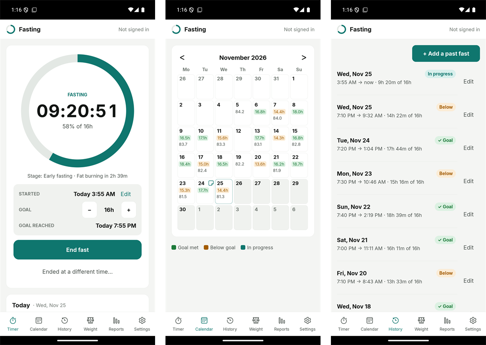
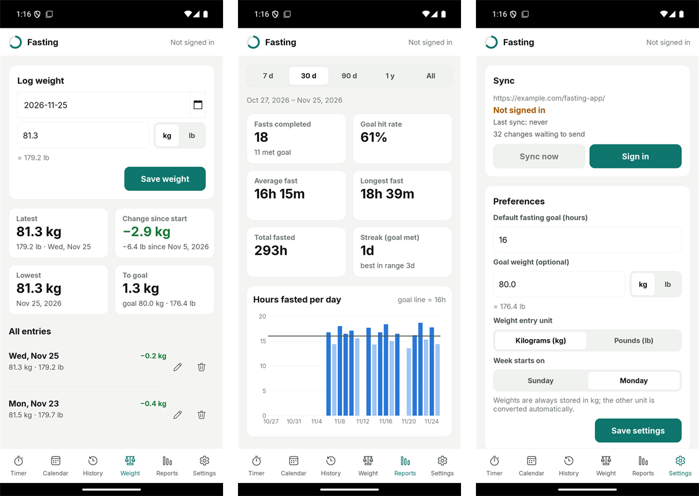
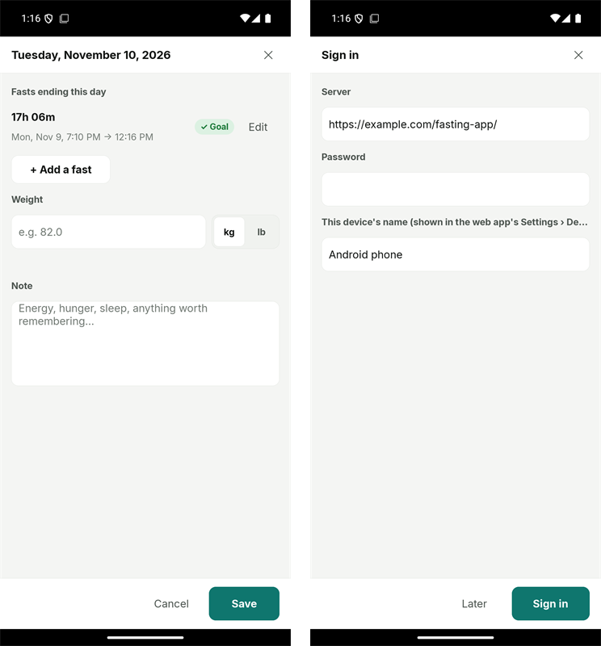
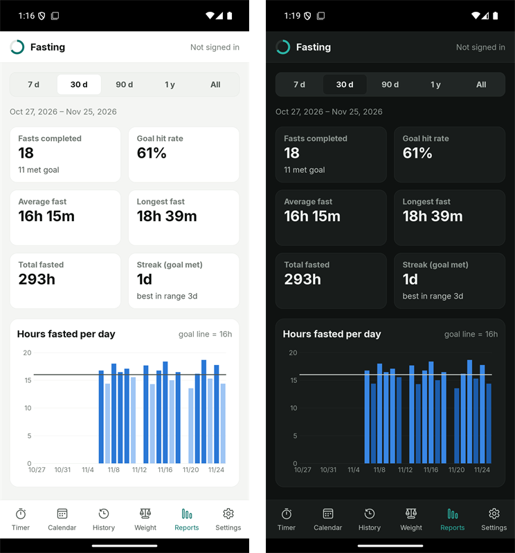

# Capstone: an Android App

```admonish warning title="Experimental"
Android support is new and still settling. It builds and runs real apps, but the `-app` options,
the `[target.x.app]` table and how tkControls behaves under a finger may still change, and it has
been tried on few devices. What this chapter shows was run on the Android Studio emulator.
```

The last capstone put one source on three desktops. This one puts a program in a pocket.
**Fasting** is a tracker for intermittent fasting: a timer for the fast that is running, a
calendar, a history, a weight log, reports and settings, with its data in SQLite on the phone and
a sync to a web server over HTTPS. It is written in tiko with tkControls, it has no Java or Kotlin
in it, and the same source runs on the desktop as a phone-sized window.



The chapter has three parts: setting up a Windows PC to build for Android, a one-button app to
prove the setup, and then the parts of Fasting that are worth copying. It joins:

- tkControls and tkApp from Chapter 36, now on a touch screen;
- `tiko build` and `tiko.toml` from Chapter 31, with a target whose `kind` is `app`;
- conditional compilation (Chapter 16), for the one place where Android differs;
- a worker thread that hands its results to the screen (Chapter 23);
- a C library, SQLite, linked into the app (Chapter 30).

## Setting up the PC

Android apps are built on **Windows**: the Windows toolchain carries the two Android targets, and
the Linux and macOS ones do not. Besides tiko and clang (Chapter 1), tiko needs three things from
Google: the **NDK**, which holds Android's C library; the **SDK**'s Build-Tools and a platform,
which pack and sign the app; and a **JDK**, because the packing and signing tools are Java.
Android Studio installs all three where tiko looks for them, so no environment variable is needed.

1. Install Android Studio from <https://developer.android.com/studio> with its defaults, start it,
   and let its Setup Wizard run (*Standard*). The SDK goes to
   `C:\Users\<you>\AppData\Local\Android\Sdk`, and the JDK comes inside Android Studio, at
   `C:\Program Files\Android\Android Studio\jbr`.
2. Open **More Actions › SDK Manager**. On **SDK Platforms** tick **Android 16, API Level 36**.
   On **SDK Tools** tick **Show Package Details**, then the newest **Android SDK Build-Tools**,
   **NDK (Side by side)** version 30 or newer, **Android SDK Platform-Tools** and the **Android
   Emulator**. Apply.
3. Open **More Actions › Virtual Device Manager**, create a phone (*Medium Phone*) with an **API
   36 x86_64** image, and start it. Or use a phone with Android 10 or newer, with *USB debugging*
   turned on in its Developer options.
4. Put the SDK's `platform-tools` on the terminal's `PATH`, for `adb`, and check that it sees the
   device:

```text
$env:Path += ";$env:LOCALAPPDATA\Android\Sdk\platform-tools"
adb devices
```

```text
List of devices attached
emulator-5554   device
```

## A first app

This is the smallest app worth installing: one button, which closes it.

```tiko
'' hello.tiko -- one button; pressing it closes the app.
#import "vendor/tkControls/tkApp"
#import "vendor/tkControls/tkButton"
using tkApp
using tkButton
using tkHost

dim shared as TK_WIDGET ptr gButton

'' Called when the button is pressed: tkApp_Run below returns, and the program ends.
sub OnClose( byval button as TK_WIDGET ptr, byval id as int32 )
    print "hello: button pressed, closing"
    tkApp_Quit( )
end sub

'' Called whenever the form gets a size (at the start, and when the phone turns): centre the button.
sub OnSize( byval f as TK_FORM ptr, byval cx as int32, byval cy as int32 )
    dim as int32 bw = tkForm_Scale( f, 200 ), bh = tkForm_Scale( f, 56 )
    tkWidget_SetPos( gButton, (cx - bw) \ 2, (cy - bh) \ 2, bw, bh )
end sub

if tkApp_Init( ) = false then print "tkApp_Init: " & *SDL_GetError( ) : end 1
var form = tkApp_NewForm( "Hello", 360, 640 )
gButton = tkButton_Create( tkForm_Widget( form ), 1 )
tkButton_SetText( gButton, "Close the app" )
tkButton_SetClickCallback( gButton, @OnClose )
tkForm_OnSize( form, @OnSize )
dim as int32 rc = tkApp_Run( form )
print "hello: bye"
end rc
```

Nothing in it is Android's. `tiko hello.tiko` makes a Windows program of it; with `-target` and
`-app` the same file becomes an app:

```text
tiko -target android-x86_64 -app hello.tiko
adb install -r hello.apk
```


`-target android-x86_64` is for the emulator, which runs on the PC's processor; a phone wants
`android-arm64`. `-app` compiles the program as a shared library, links SDL3 and tkControls into
it, adds Android's start-up code and the fonts, writes the manifest, packs it all into
**`hello.apk`** and signs that with a **debug key**, which tiko makes the first time in
`C:\Users\<you>\.android\debug.keystore`. On the device the window is the whole screen, whatever
size the program asked for. Tap the button and the app closes. `print` has no console there: its
lines go to Android's log.

```text
adb logcat -s tiko
```

```text
I tiko    : hello: button pressed, closing
I tiko    : hello: bye
```

The app's identity lives in `tiko.toml`, so the command line stays short (Chapter 31):

```toml
[package]
name = "hello"

[target.hello]
main = "hello.tiko"
kind = "app"

[target.hello.app]
id      = "com.example.hello"    # never changes once the app is published
label   = "Hello"                # the name under the icon
version = "1.0,1"                # what users see, and the number Android compares
```

`tiko build hello -target android-arm64` writes `out/debug/hello.apk`. The table takes the rest of
`-app`'s options too: `icon`, `assets`, `permissions`, `key` and `bundle`.

## The Fasting app



### The project

| Path | Holds |
|---|---|
| `tiko.toml` | a `desktop` target, a `fasting` app signed with the debug key, a `fasting-release` app signed with its own key |
| `src/main.tiko` | opens the database and runs the app |
| `src/model/` | fasts, weights, notes and settings; days, formats and the report's sums |
| `src/store/` | the phone's SQLite database: a copy of the data, and an outbox of changes not yet sent |
| `src/sync/` | talking to the server |
| `src/ui/` | the form, six pages, the editor pages, fields and the theme |

The app target asks for one permission. Without it Android refuses every network call the app
makes, with a `SecurityException` on the Java side:

```toml
[target.fasting.app]
id = "com.example.fasting"
label = "Fasting"
version = "0.1,1"
icon = "res/icon.png"
permissions = ["INTERNET"]
```

On Android the working directory is the app's private storage, so `main.tiko` opens a plain
`fasting.db` and the database lives there, kept until the app is removed.

### One form, six pages

A phone app has one window, the whole screen. Fasting makes one form with `tkApp_NewForm`, 412 by
860 on the desktop, and puts on it a top bar, a navigation bar of six buttons at the bottom, and
six pages between them, one shown at a time. Each page is a `tkScrollPanel` whose content is a
**`tkStack`**: a column of controls, each after the one before, which is how most phone screens are
laid out. A **card** is a panel with a stack of its own, and a row is a horizontal stack:

```tiko
dim as TK_STACK ptr rg = tkStack_Create( tRowGoal, TK_STACK_HORIZONTAL )
tkStack_AddFill( rg, gl )                    '' the label takes what is left
tkStack_Add( rg, tBtnDec, 40 ) : tkStack_Add( rg, tGoalVal, 64 ) : tkStack_Add( rg, tBtnInc, 40 )
tkStack_AddStack( ss, tRowGoal, rg, 44 )     '' the row goes into the card's column, 44 high
```

Sizes are design units, and on a phone a design unit is a **dp**, a density-independent pixel: the
navigation buttons are at least 48 high, the size Android's guidelines give a fingertip, on any
screen. tkControls keeps the form inside the **safe area**, clear of the status bar, the
navigation bar and a camera cutout.

Each page is a module that registers the procedure that builds it, so the form knows nothing of
what is on a page. And none of it is Android code.

### Touch, and editor pages



tkControls turns touch into what the controls already understand: a tap is a click, a swipe
scrolls a panel and flings it, a long press is a right click. Three controls have a setting for a
finger, which has no hover and no double click: the calendar opens a day on one tap
(`SetActivateOnClick`), the charts pin the nearest point on a tap and keep its value shown
(`SetTapToInspect`), and a numeric text box asks Android for the **number pad**, with a decimal
point when it has decimal places.

Tapping a day, *Edit* or *Add a past fast* opens an **editor page**, a form of its own made with
`tkApp_NewForm` as on the desktop. On Android every form after the first is drawn inside the one
window, over the whole screen, and Android's **BACK** gesture closes the top one as *Cancel*
does. The app has no code of its own for BACK.

### Talking to the server

Sync sends the changes made on the phone and gets back everything else, as JSON over HTTPS,
through one function that makes a request. That function is the one place where the phone and the
desktop differ. On the desktop it is `std/http`. On Android `std/http` has no TLS library to use,
so the function calls Android's own `java.net.HttpURLConnection` through JNI, with the `JNIEnv`
that `SDL_GetAndroidJNIEnv( )` returns; Android's TLS and certificate store do the rest.

```tiko
#ifndef TIKO_OS_ANDROID
public function HttpDefault( ... ) as HttpReply     '' std/http
    ...
end function
#else
public function HttpDefault( ... ) as HttpReply     '' HttpURLConnection, over JNI
    ...
end function
#endif
```

Sync runs on a worker thread so that the screen never waits for the network, and the worker hands
each result to the screen with `tkApp_RunOnUI`, because only the thread that made the controls
may touch them (Chapter 36). One thing is Android's own. **A thread that calls Java must
have a real stack**: with `threadcreate`'s default, the first JNI call on that thread stops the app.

```tiko
gSyncThread = threadcreate( @SyncWorker_, 0, 1024 * 1024 )     '' 1 MB: it calls Java on Android
```

The app also syncs when it comes back to the front. SDL reports that as
`SDL_EVENT_DID_ENTER_FOREGROUND`, which an event watch (`SDL_AddEventWatch`) sees as it happens.

A change made with no network, or before signing in, is written to the SQLite copy and queued in
the outbox **in one transaction**, so the screens behave the same either way, and the queue goes
at the next sync. SQLite, the JSON library and SDL3 all link statically: the APK carries one native
library, `libmain.so`, with everything inside.

### Light and dark



The app gives tkApp two palettes, `tkApp_SetThemePair( dark, light )`, and its *System* setting is
`tkApp_SetThemeMode( TKAPP_THEME_SYSTEM )`, which follows the phone's dark mode as it changes.
What the app paints itself, the ring and the calendar's days, reads its colours from the palette
in force, and `tkForm_OnThemeChanged` repaints it after a switch.

### Building, and a release

Most of the work happens on the desktop, where a build takes seconds:

```text
tiko build desktop
tiko build fasting -target android-x86_64
adb install -r out\debug\fasting.apk
```

With `TK_VIRTUAL=1` set, tkControls draws the desktop window as it draws on Android, editor pages
inside the one window, so the layout can be checked before a phone is involved.

A release is signed with the app's **own key**, made once with `keytool` and kept safe: every
later version must be signed with the same key and have a higher version number, or the phone
refuses it as an update. tiko reads the key's password from an environment variable, never from
the command line:

```toml
[target.fasting-release.app]
id = "com.example.fasting"
label = "Fasting"
version = "0.1,1"
icon = "res/icon.png"
key = "keys/fasting-release.jks,fasting"
permissions = ["INTERNET"]
```

```text
$env:TIKO_ANDROID_KS_PASS = Read-Host "Keystore password"
tiko build fasting-release --profile release -target android-arm64
```

`bundle = true` in the table, or `-appbundle` on the command line, makes an **App Bundle**
(`.aab`) instead, which is what Google Play takes.

## What the phone taught

- **No permission, no network.** Android asks the manifest, not the code.
- **A thread that calls Java needs a stack.** The default is too small for the Java VM to attach.
- **Gesture bars are not unsafe.** SDL counted the gesture zones down each side of the screen as
  unsafe, and every page lost a band down both edges; tkControls keeps clear of the system bars
  and a cutout only.
- **Rounding differs at 2.625.** A height written one way and drawn another differed by a pixel at
  the emulator's density, and a card lost its bottom edge on the phone only. Compute a size once.
- **A finger has no hover.** Anything that showed itself on hover needs a tap.

## Exercises

1. Give `hello.tiko` an icon of your own and the label *Hello, phone*, in `tiko.toml`, and install
   it over the first one. What happens if you lower the version number?
2. Add a second button that adds one to a counter shown on the first. Turn the phone (Ctrl+Left on
   the emulator): what calls put the buttons back in place?
3. Print the value of `exepath` and of `curdir` from the app, and read them with `adb logcat`.
   Where would a file the app writes go?
