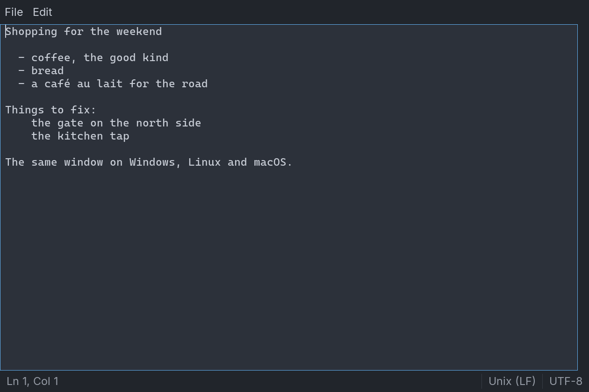

# Capstone: a Cross-Platform Notepad

The `tpad` of Chapter 36 runs on one operating system, because every control in it draws with GDI
and every message it handles is a Windows message. What would it take to run the same editor
on Linux and on a Mac, and is the answer a port or a rewrite?

This chapter finds out. It builds **`tpad`** again, on **tkControls**, the vendor package of
controls that draw into SDL3 windows, and **one source builds and runs on Windows, Linux and
macOS**. The menus, the Find box, the status bar and the question before unsaved work is thrown
away are the same. So is the document module, which does not change by a byte.

The window module is new, and most of what is interesting here is the short list of things that
only show up once a program leaves Windows: a file dialog that does not stop your code, a text
control that counts in bytes, a command key that is not Ctrl, and a Quit that arrives from the
system and never touches your window. It joins:

- the module split of Chapter 36, tested by reusing its result;
- procedure pointers and lambdas (Chapters 7 and 21), which is still how every control reports back;
- a C library's callback, and the thread it may arrive on (Chapters 23 and 30);
- text as units and as bytes (Chapter 9);
- conditional compilation by platform (Chapter 16);
- `tiko build`, and what a program built on shared libraries takes with it (Chapter 31).

Read Chapter 36 first. This chapter says what is different and why, and does not repeat what is
the same.



## The specification

```text
tpad [file]
tpad --selftest
tpad --shot out.bmp [file]
```

The specification of Chapter 36 stands, with these changes:

- **It runs on Windows, Linux and macOS**, from one source with no per-platform files.
- **The command key is Cmd on macOS** and Ctrl elsewhere, for `tpad`'s own keys and the text box's,
  and the menus say which.
- **Text is any UTF-8**: selection, Find and the line and column are right after accented letters
  and other characters that are not ASCII.
- **The question before discarding also covers the system's Quit**: Cmd+Q on a Mac, or a logout.
- **`--shot`** renders the window once and saves it as a picture, so that two systems can be
  compared.

## The layout

```text
ch37/
    tiko.toml               the package, and the target tpad
    textfile/textfile.tiko  the document: identical to Chapter 36's
    offsets/offsets.tiko    UTF-8 bytes and ustring units
    offsettest.tiko         offsets on its own, on every target
    pad/pad.tiko            the window: controls, menus, commands
    tpad.tiko               the program, and its self-test
```

```toml
{{#include ../examples/ch37/tiko.toml}}
```

That is the whole manifest. Chapter 36's needed a `UNICODE` define, a resource file and a
manifest for DPI awareness; SDL3's strings are UTF-8 on every system, and SDL3 makes a window
DPI-aware by itself.

## The document

`textfile/textfile.tiko` is a copy of Chapter 36's, and `cmp` finds no difference between the two.
That was the point of keeping the part that needs no window in a module that imports none: the
module never knew which controls would show it, so it had nothing to change. Everything Chapter 36
said about it holds, including the rule that matters most here, that inside a `Document` a line
break is one character, LF.

## What a window is made of

```tiko
{{#include ../examples/ch37/pad/pad.tiko:head}}
```

One program-level idea replaces several. In Chapter 36 every control was a Windows window with a
handle, and a form found its controls by their ids. A **tkControls window is one SDL window**, and
everything in it is a `TK_WIDGET`: a record in a tree that the library draws and sends events to.
There is no handle to look up, so the program keeps a pointer to each control it talks to:

```tiko
{{#include ../examples/ch37/pad/pad.tiko:state}}
```

The shape is Chapter 36's. An `Editor` holds everything about the window, the form's `Tag` points
at it, and a control's callback gets from the control to the `Editor` through `EditorOf`:
`tkForm_FromWidget` finds the form, and the form's `Tag` finds the `Editor`. `Cmd` is unchanged.
The new field is `picking`, which a later section needs.

The message box is the same call with a different prefix:

```tiko
{{#include ../examples/ch37/pad/pad.tiko:ask}}
```

## A dialog that does not stop your code

The file dialog is where the two systems' habits part. On Windows, `CIOpenFileDialog` does not
return until the person has chosen. SDL3's dialogs **return at once and answer later**, through a
callback, because on some systems a dialog cannot be run any other way. Worse for a program that
wants to read an answer, the callback **may run on another thread**.

`tpad`'s commands want a function that returns a path, so `PickFile` builds one:

```tiko
{{#include ../examples/ch37/pad/pad.tiko:pick}}
```

It starts the dialog, then turns the event loop by hand until the answer arrives, so the window
keeps painting and SDL keeps delivering events.

Everything the callback does is chosen for the thread it may be on. It is handed `@w`, so it
needs no global. It copies the path with `SDL_strdup`, which is C memory and owes nothing to tiko's
string runtime, and it signals with an atomic integer (Chapter 23). Only back on the waiting thread
does the copy become a `ustring`. The order matters: `path` is written first, and the atomic's write
is what tells the waiting thread that it is safe to read.

If the system has no dialog to show, SDL calls back with no list at all, and `PickFile` returns
`""`, as if the person had cancelled. On Linux the dialog comes from the desktop's portal or from
`zenity`, so a stripped-down machine can reach that path.

````admonish danger title="Pitfall"
A dialog that returns at once leaves the event loop running, and a running event loop will deliver
anything. If the window is not blocked for you, the person can choose File > Exit while the dialog
is open. `MayDiscard` finds nothing unsaved, the form is destroyed, its `OnDestroy` deletes the
`Editor`, and when the dialog does answer, the code waiting for it carries on with a pointer to
memory that has been freed.

Whether a system blocks the parent window is the system's decision, so `PickPath` does not depend
on it. It sets `picking`; `Execute` starts nothing while it is set, and the form's close handler
refuses. The self-test tries it, with a scripted person who closes the window from inside the
dialog:

```text
== File > Exit while the file dialog is open
  window closed: false
```

With the close handler's one line removed, that line reads `true`.
````

## The text, and the callback that runs afterwards

```tiko
{{#include ../examples/ch37/pad/pad.tiko:text}}
```

The third argument makes a multiline box, as it did in Chapter 36, and `tkForm_Font( f, TKFONT_MONO )`
is the form's monospaced font, which the package ships.

The four callbacks are the four from Chapter 36, and the change callback still fires only for a
person's edits. The one with a different mechanism is the message callback. It runs *before* the
box acts on a key, so the caret has not moved yet. Chapter 36 posted itself a Windows message;
**`tkApp_RunOnUI` is the same idea without Windows**. It queues `CaretMoved` to run when the
current event has been handled, by which time the caret is where the key put it.

### The status bar

```tiko
{{#include ../examples/ch37/pad/pad.tiko:status}}
```

There is less here than in Chapter 36, because a `tkStatusBar` draws its own panels. Setting a
panel's text is all there is to do, and its Pitfall about blank panels has no counterpart.

## Two ways of counting

```tiko
{{#include ../examples/ch37/pad/pad.tiko:refresh}}
```

`ShowTitle` hands SDL the caption as UTF-8: `title` is a `string`, and assigning a `ustring` to it
stores the text's UTF-8 bytes. `ShowStatus` is Chapter 36's with one call added, and that call is
the subject of this section.

A `tkTextBox` holds its text in UTF-8 and **its offsets count bytes**. A `ustring` counts **UTF-16
units** (Chapter 9), and so do `len`, `instr` and everything in `textfile`. While every character
before the offset is ASCII, the two numbers are equal. The first character that is not, and they
are not:

```tiko
{{#include ../examples/ch37/offsets/offsets.tiko:all}}
```

The two functions do the conversion by letting tiko do it: take the prefix in one form, turn it into
the other, measure. They need no window, so they get a module and a test of their own:

```tiko
{{#include ../examples/ch37/offsettest.tiko}}
```

```text
{{#include ../examples/ch37/offsettest.out}}
```

An e-acute is one unit and two bytes. U+1F600 is two units and four bytes. Both directions land on
a boundary between characters, and the box snaps an offset to one in any case.

````admonish danger title="Pitfall"
Nothing about this mistake is visible with ASCII text, and every test written in English passes.
Take out the three conversions in `pad`, and open a file whose first line is `café au lait` and
whose second is `naïve lait`. Find Next for `lait` selects:

```text
== text that is not ASCII, Find Next for "lait", twice
  selected:  lai
  status: Ln 1, Col 13 | Unix (LF) | UTF-8
  selected: e la
  status: Ln 2, Col 11 | Unix (LF) | UTF-8
```

The search worked and the selection is wrong, by one byte for each character before it that took
two. The status bar is right, for the wrong reason: the position it measured was the one the
selection had been given. A file that is only slightly non-English looks fine until someone uses
Find.

This is the same mistake as Chapter 36's Pitfall about line breaks, in another unit. Each control
counts in its own way, so give the program one way, and convert where the two meet.
````

## Layout, menus, keys

```tiko
{{#include ../examples/ch37/pad/pad.tiko:layout}}
```

Controls start with no size and `OnSize` places them. `tkForm_Scale` takes the place of `ScaleX` and
`ScaleY`: an SDL window has one scale.

```tiko
{{#include ../examples/ch37/pad/pad.tiko:menus}}
```

A `tkMenuBar` holds the titles and each drops down a `tkPopupMenu`, as in Chapter 36. There is no
accelerator table. The text box handles the primary key with Z, X, C, V and A itself and **leaves
every other key unclaimed**, and an unclaimed key reaches the form's `OnKeyDown`. Returning `true`
says that it was used.

The primary key is the first thing in this chapter that is written differently for one system.
`TK_KMOD_PRIMARY`, from `tkHost`, is the Cmd key on macOS and Ctrl elsewhere, and the text box tests
it too, so `tpad` writes that name once. Only the menu's *label* needs the platform spelled out,
so that is the only `#if` in the program (Chapter 16).

### Commands

```tiko
{{#include ../examples/ch37/pad/pad.tiko:commands}}
```

`Execute` is Chapter 36's, with its first line new: while a file dialog is waiting, no command
starts.

## Files, and Find

```tiko
{{#include ../examples/ch37/pad/pad.tiko:files}}
```

Apart from where the path comes from, this is Chapter 36's code with the prefixes changed.
`tkTextBox_SetText` is silent, as a setter
should be, and the modified flag is cleared after a load and a successful save.

```tiko
{{#include ../examples/ch37/pad/pad.tiko:finding}}
```

`FindAgain` converts twice: the selection's end into units for `textfile`, and the match back into
bytes for the box. `tkTextBox_SetSel` scrolls the caret into view itself, so there is nothing after
it. Enter in the search box is Find Next, through the box's Enter callback, and Esc ends a modal
form with `TKAPP_IDCANCEL` without being asked. Because `tkForm_ShowModal` returns only once the box
is closed, its `FindBox` can live on the stack of `AskWhatToFind`.

## A Quit that is not a close

The close button goes through `OnClose`. The system's own Quit does not.
SDL gives every Mac application a menu with **Quit** on it, and Cmd+Q reaches the program as
`SDL_EVENT_QUIT`, an event that belongs to no window. A logout can arrive the same way. tkControls
responds by marking every window closed, and the program ends with the question never asked.

```tiko
{{#include ../examples/ch37/pad/pad.tiko:quit}}
```

`tkHost_AddEventHook` is called for every event before the library looks at it, and a hook that
returns `true` has dealt with it. `QuitHook` turns the system's Quit into an ordinary close of the
main window, which runs `OnClose`, which asks. An event hook is handed the event and nothing else,
so `MainEditor` keeps a pointer in a `static` for it. It is the one piece of state in the program
that is not in the `Editor`, and it is there because the C-shaped callback left no place for it.

```admonish danger title="Pitfall"
The window's close button is an event for the window, and it is the one you remember to handle.
With the hook removed, the self-test's Quit closes the window with unsaved text in it and no
question: the two lines `asked:` and `answered:` vanish, and `window closed:` reads `true`. On
Windows nothing a person ordinarily does produces this event, which is why a program developed
there does not find out.
```

## Creating it all

```tiko
{{#include ../examples/ch37/pad/pad.tiko:create}}
```

Chapter 36's `Create` needed a DPI handler, because PsApp gives every control the form's UI font
when the scale changes. Here a scale change re-sizes the fonts each control was given and hands out
no others, so there is nothing to put back. The self-test still checks it, because the fact is the
library's and could change. `forcedScale` pins a scale instead of the display's.

## The program

```tiko
{{#include ../examples/ch37/tpad.tiko:head}}
```

```tiko
{{#include ../examples/ch37/tpad.tiko:main}}
```

`#cmdline "-s gui"` matters on Windows, where it means no console window; the other two systems
make no such distinction. `tkApp_Run` shows the form and runs the event loop until it closes, and
its result is the exit code. Under `--selftest` and `--shot` the loop never runs.

## Testing on three systems

The test is Chapter 36's idea, and it is more valuable here. It drives the real window, with the
person behind `ask` and `pick`:

```tiko
{{#include ../examples/ch37/tpad.tiko:script}}
```

```tiko
{{#include ../examples/ch37/tpad.tiko:drive}}
```

Where Chapter 36 sent `WM_KEYDOWN` and `WM_CHAR` to a window, this one pushes SDL events onto the
queue, where the system would put them. Three things follow from that:

- **Pump after every event.** `SDL_PushEvent` only queues it.
- **Size the window, then wait.** A system applies a new window size when it gets to it, and a
  key sent to a text box with no size moves
  nothing. `PumpFor` gives it time, and the layout is checked by comparing edges rather than pixels.
- **An event's text has to outlive the event.** `SDL_EVENT_TEXT_INPUT` points at its string, so
  `TypeText` keeps it in a `static`.

```tiko
{{#include ../examples/ch37/tpad.tiko:test}}
```

```text
{{#include ../examples/ch37/tpad.out}}
```

The book's harness compares that output with what the program prints on all three systems, and
there is one `.out` file for all of them. On Linux it also holds under both SDL video drivers, X11
and Wayland.

The first 36 lines are Chapter 36's, byte for byte. The two self-tests are the same script run
against two window systems, so that agreement says more about both programs than either test
says alone. The sections after it are the ones this chapter added: text that is not ASCII, the dialog,
the system's Quit.

### What the self-test cannot see

The self-test reads the model, and Chapter 36's lesson stands: it cannot see pixels. `--shot` is
for that:

```tiko
{{#include ../examples/ch37/tpad.tiko:shot}}
```

It runs at a fixed scale, in the dark theme, and saves a bitmap; the picture at the top of the
chapter is one. Reading the pixels back needs the second argument of `tkHost_RenderTo` to be
`false`, because on Metal the back buffer is black once it has been presented. With the same scale
on two systems you can compare the files, and what remains is small: mostly a level or two of
anti-aliasing, from one platform's build of SDL3_ttf to another's.

The real file dialogs and the real message box are the other thing the test does not reach. They
are behind `pick` and `ask` because they wait for a person, and that person has to try them once on
each system.

## Running it

From the chapter's directory:

```text
tiko build tpad
out/debug/tpad notes.txt
```

On Windows the program is `out/debug/tpad.exe`. The first build compiles the tkControls modules the
program imports; later builds compile only what changed. `tiko run -- notes.txt` builds and starts it
in one step.

## Shipping

`tiko build tpad --profile release` writes an optimised program, and the build copies what it needs
beside it. What that is differs by system:

| | The program | Beside it | The folder |
|---|---|---|---|
| Windows | 337,920 bytes | the fonts, `SDL3.dll`, `SDL3_ttf.dll`, `SDL3_image.dll` | 10.3 MB |
| Linux | 348,888 bytes | the fonts | 5.0 MB |
| macOS | 361,480 bytes | the fonts | 5.0 MB |

On **Windows** the folder is the installation: the toolchain ships the three SDL libraries and copies
them. The fonts are Inter, Cascadia Mono and Fluent UI System Icons, with their licences, and they
are why the program looks the same everywhere.

On **Linux and macOS** the program links the system's SDL3 and needs it on the machine that runs it.
On a Mac that is `brew install sdl3 sdl3_ttf sdl3_image`. On Linux it is the distribution's SDL3
packages, and where a distribution has none yet,
`examples/tkControls/tools/build-linux-libs.sh`, which comes with the toolchain, builds them.
Tell the link where they are with `tiko build tpad --options "-p /path/to/libs"`, and the program
with `LD_LIBRARY_PATH` or an installed copy.

## What changed from Chapter 36

| Chapter 36, PsControls | Here, tkControls |
|---|---|
| `PsApplication`, `PsForm`, `f->Item( id )` | `tkApp_Init`, `TK_FORM`; the `Editor` keeps its widget pointers |
| `PsForm.FromHwnd( h )->Tag` | `tkForm_FromWidget( w )->Tag` |
| Posting `WM_CARETMOVED` to the form | `tkApp_RunOnUI( @CaretMoved, ed )` |
| An accelerator table | `tkForm_OnKeyDown`: keys the text box leaves unclaimed |
| A modal `CIOpenFileDialog` | `SDL_ShowOpenFileDialog`, waited for by `PickFile` |
| `SetWindowTextW`, in UTF-16 | `SDL_SetWindowTitle`, in UTF-8 |
| Offsets that match `ustring` units | UTF-8 offsets, converted by `offsets` |
| `EM_SCROLLCARET` after `SetSel` | Nothing: `SetSel` scrolls into view |
| A status-bar paint callback | Nothing: `tkStatusBar` draws its panels |
| `OnDpiChanged` restores the monospaced font | Nothing: a scale change keeps each control's font |
| Ctrl | `TK_KMOD_PRIMARY`: Cmd on macOS |
| The window's close | The close, and the system's `SDL_EVENT_QUIT` through a hook |
| `tpad.rc`, a manifest, `UNICODE` | Nothing |
| `WM_KEYDOWN`, `WM_CHAR` in the self-test | `SDL_EVENT_KEY_DOWN`, `SDL_EVENT_TEXT_INPUT` |

## What it costs

- **A larger installation.** Chapter 36's `tpad` is one 316 KB file that imports only what comes with
  Windows. This one is about the same size, and it brings 10 MB of libraries and fonts on Windows
  and needs SDL3 installed elsewhere. Portability is paid for in what you ship.
- **Every caret move reads the whole text, and now converts it.** Measured on a 1 MB file in a
  release build on Windows, `ShowStatus` takes about 10 ms, of which under 2 ms is
  `tkTextBox_GetText` and the rest is copying and counting. A notes file costs nothing; a large log
  would make the caret lag.
- **The controls are drawn, not provided.** A `tkTextBox` looks and behaves the same on every system,
  which is the reason for using it, and for the same reason it is nothing the system recognises.
  There is no accessibility interface, so a screen reader sees an empty window. The menu bar is in
  the window, on a Mac too, not in the Mac's menu bar at the top of the screen.
- **The column counts UTF-16 units.** A character outside the Basic Multilingual Plane, such as
  U+1F600, moves the column by two. Exercise 1 fixes it.
- **A new document is saved with CR LF on every system**, because `textfile` was written for
  Windows, and the status bar says so honestly. A file that was read keeps its own ending. Exercise 2
  fixes it.
- **The text always wraps**, as in Chapter 36: a multiline box wraps and has no horizontal scroll bar.
- **The same limits as Chapter 36** on the file in memory, and on text that is not UTF-8.

## Summary

- A module that imports no window moves to a new window system unchanged. `textfile` is the
  same file in both chapters.
- tkControls replaces handles and messages with a `TK_WIDGET` tree in one SDL window. Keep a pointer
  to each control you talk to, and reach the program's state from a callback through
  `tkForm_FromWidget` and the form's `Tag`.
- SDL3's file dialogs return at once and answer through a callback that may run on another thread.
  Wait for the answer by turning the event loop, and have the callback touch nothing but C memory
  and an atomic.
- While a loop turns under a dialog, anything can be delivered. Refuse new commands and the close
  until the dialog answers, or an `Editor` can be freed underneath the code waiting on it.
- `tkTextBox` offsets are UTF-8 bytes and a `ustring` counts UTF-16 units. They agree for ASCII and
  nowhere else. Convert at the edge, in one place, and test with text that is not English.
- `tkApp_RunOnUI` runs code after the current event, as a posted message did.
- `TK_KMOD_PRIMARY` is Cmd on macOS and Ctrl elsewhere. Only the menu's label needs `#if`.
- A system's Quit is `SDL_EVENT_QUIT`, an event that belongs to no window. Turn it into a close
  with an event hook, or it skips the question before discarding.
- One self-test and one expected output, run on every system, is what shows that the program is one
  program. Push SDL events, pump after each, and wait after resizing. `--shot` covers the pixels.
- A program built on SDL3 ships its libraries and fonts on Windows, and asks for SDL3 on Linux and
  macOS.

## Exercises

1. Make the status bar's column count characters, so that U+1F600 counts as one. A ustring holds
   such a character as two units, and the second is a low surrogate. {solution="ex37-01"}
2. Make a new document use the line ending of the system it was started on, through a
   `NewDocument` function and `#if`, while a file that was read keeps its own. {solution="ex37-02"}
3. Port Find Previous (Shift+F3) from Chapter 36's exercises. Mind which count each side uses.
4. On macOS, make File > Exit read Quit, with Cmd+Q as its key, while Windows and Linux keep Exit.
5. Open a file dropped on the window. Add an event hook for `SDL_EVENT_DROP_FILE`, whose `data` field
   is the path in UTF-8, and call `MayDiscard` first.
6. Remember the window's size between runs, in a file under the folder `SDL_GetPrefPath` returns, and
   check that the same code finds the right place on all three systems.
