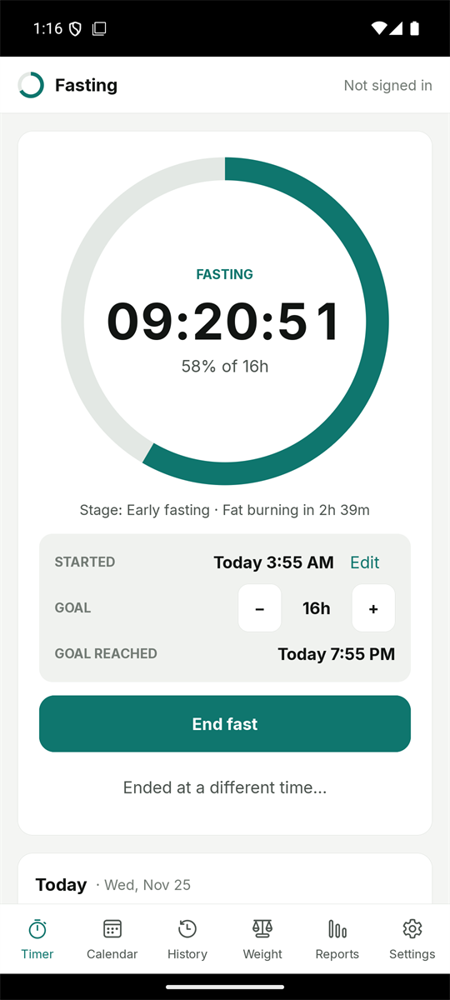
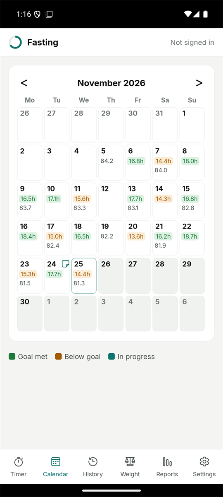
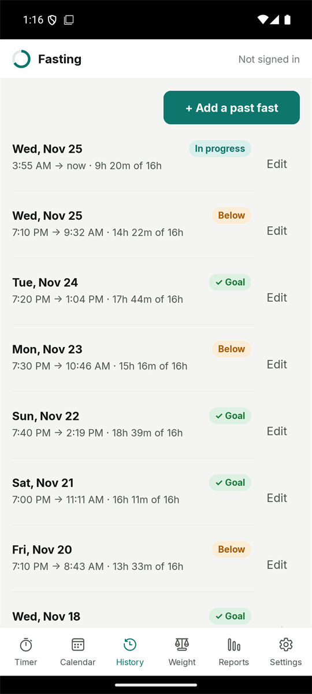
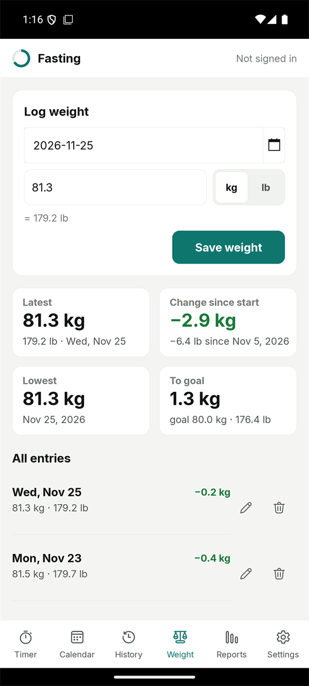
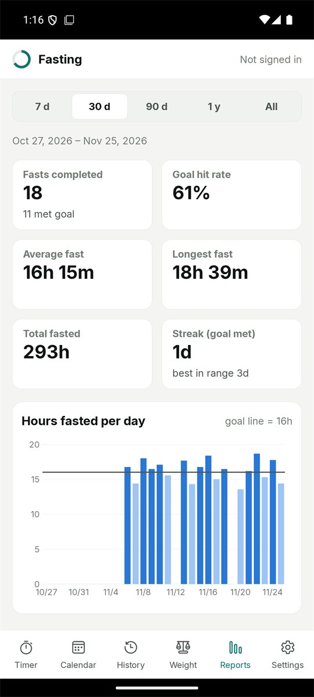
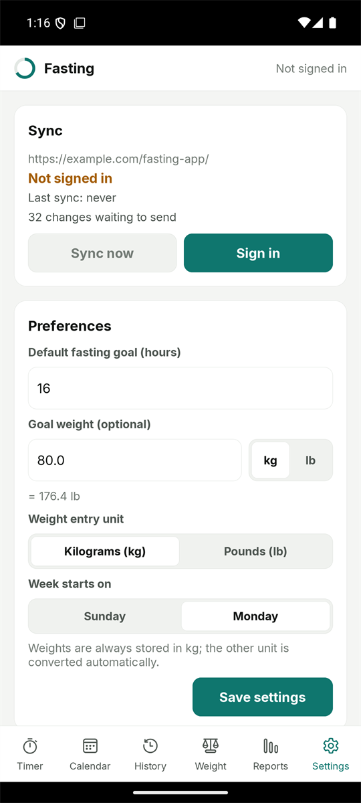
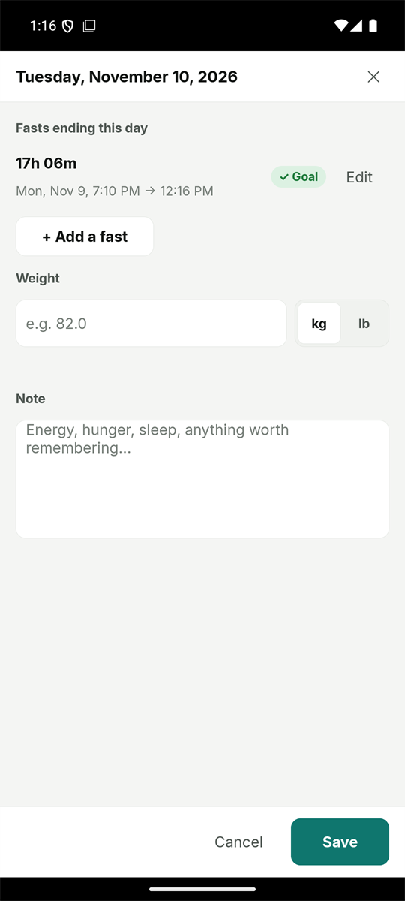
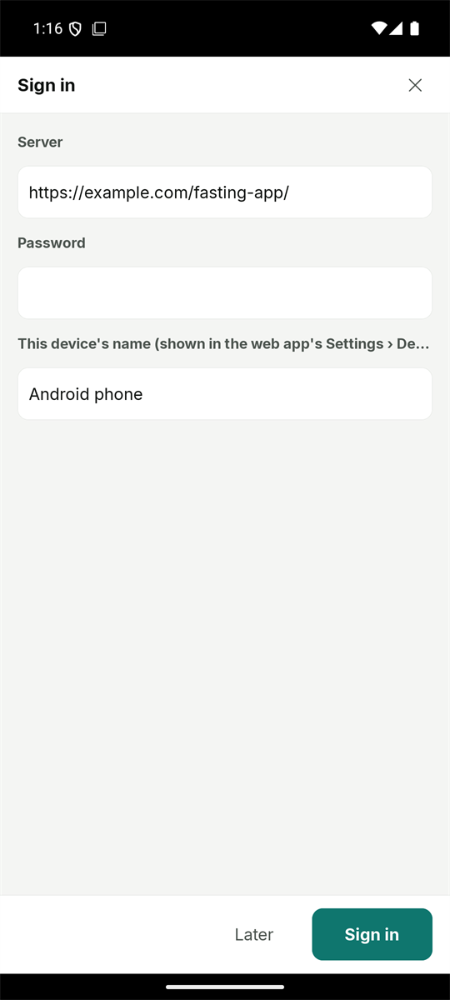
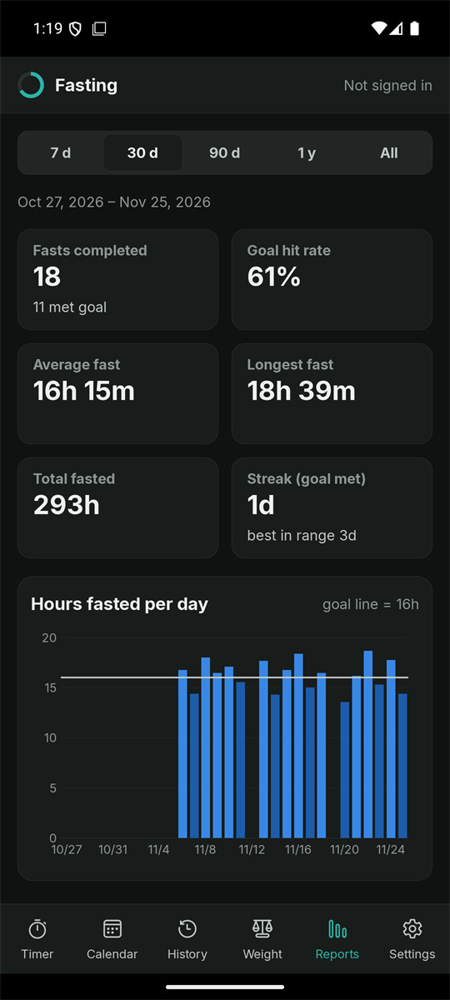

[Home](Home) › [Android](Android) › **Android App Tutorial: Fasting**

# Android App Tutorial: Fasting

> **Experimental.** Android support is new and still settling: the `-app` options and how
> tkControls behaves on a phone may still change. See [Android](Android) for what works today.

This page follows a complete app from an empty folder to a signed release on a phone: **Fasting**,
a tracker for intermittent fasting. It has six screens, keeps its data in SQLite on the phone,
syncs with a web server over HTTPS, follows the phone's light or dark setting, and is built from
**one tiko source** that also runs on the desktop as a phone-sized window. It uses
[tkControls](Category-tkControls) for everything on the screen and has no Java, Kotlin or
Android Studio project.

Every picture below was taken on the Android Studio emulator (API 36, 1080 × 2400) with sample
data. The code is shortened from the app's own; its full source is not part of the toolchain.

Set up the PC first with the [Android Setup Tutorial](Android-Setup-Tutorial): it installs what
every step here needs.

## Contents

1. [What it does](#1-what-it-does)
2. [The project](#2-the-project)
3. [One form, six pages](#3-one-form-six-pages)
4. [A page: the Timer](#4-a-page-the-timer)
5. [Lists, a calendar and charts](#5-lists-a-calendar-and-charts)
6. [Editor pages and the BACK button](#6-editor-pages-and-the-back-button)
7. [Talking to the server](#7-talking-to-the-server)
8. [The data on the phone](#8-the-data-on-the-phone)
9. [Light and dark](#9-light-and-dark)
10. [Run it on the desktop first](#10-run-it-on-the-desktop-first)
11. [Build it, install it, run it](#11-build-it-install-it-run-it)
12. [A signed release for a phone](#12-a-signed-release-for-a-phone)
13. [What the phone taught us](#13-what-the-phone-taught-us)

---

## 1. What it does

| Timer | Calendar | History |
| --- | --- | --- |
|  |  |  |

| Weight | Reports | Settings |
| --- | --- | --- |
|  |  |  |

- **Timer:** start and end a fast, see how long it has run against the goal, change the goal.
- **Calendar:** a month at a glance; tap a day to see its fasts, weight and note.
- **History:** every fast, newest first, to edit or add one that was not timed.
- **Weight:** log a weight in kg or lb, see the trend.
- **Reports:** totals, streaks and a chart for the last 7, 30 or 90 days, the year or everything.
- **Settings:** sync, the goal, units, the week's first day and the theme.

## 2. The project

The app is a folder with a `tiko.toml` and a `src` folder:

| Path | What is in it |
| --- | --- |
| `tiko.toml` | the project: a desktop target and two app targets |
| `src/main.tiko` | start-up: opens the database and runs the app |
| `src/model/` | the data: fasts, weights, notes, settings; days, formats and the report's sums |
| `src/store/` | the phone's SQLite database |
| `src/sync/` | talking to the server |
| `src/ui/` | the form, the six pages, the editor pages, fields, the theme |
| `res/icon.png` | the launcher icon, 512 × 512 |

`tiko.toml` names one main file three times: for the desktop, for an app to test with, and for
the release signed with the app's own key.

```toml
[package]
name = "fastingtk"

[target.desktop]                 # a phone-sized window on Windows, Linux or macOS
main = "src/main.tiko"
output = "out/fasting.exe"
subsystem = "gui"

[target.fasting]                 # the app, signed with the debug key: for testing
main = "src/main.tiko"
kind = "app"

[target.fasting.app]
id = "com.example.fasting"
label = "Fasting"
version = "0.1,1"
icon = "res/icon.png"
permissions = ["INTERNET"]       # it talks to a server

[target.fasting-release]         # the same app, signed with its own key
main = "src/main.tiko"
kind = "app"

[target.fasting-release.app]
id = "com.example.fasting"
label = "Fasting"
version = "0.1,1"
icon = "res/icon.png"
key = "keys/fasting-release.jks,fasting"   # its password comes from TIKO_ANDROID_KS_PASS
permissions = ["INTERNET"]
```

`kind = "app"` is what makes `tiko build` produce an APK; `[target.x.app]` holds what
[`-app`](Compiler-Option-App)'s options would say on a command line. **`permissions = ["INTERNET"]`
matters:** without it Android refuses every network call the app makes.

`src/main.tiko` is short. On Android the working directory is the app's private storage, so a
plain file name is a file the app owns:

```freebasic
'' fasting -- on Android the database is in the app's own storage (the working directory);
'' on the desktop, the path given, else fasting.db.
#import "./ui"
using ui

dim as ustring dbPath = command( 1 )
if len( dbPath ) = 0 then dbPath = "fasting.db"
TimerPageRegister( )
CalendarPageRegister( )
HistoryPageRegister( )
WeightPageRegister( )
ReportsPageRegister( )
SettingsPageRegister( )
end AppMain( dbPath )
```

## 3. One form, six pages

A phone app has one window, the whole screen. The app makes **one form** with
[tkApp](tkApp) and puts everything on it: a top bar, a navigation bar of six buttons at the bottom,
and six pages between them. Each page is a [tkScrollPanel](tkScrollPanel) with a
[tkStack](tkStack) inside, and only one page is shown at a time. Shortened:

```freebasic
public function AppMain( byref dbPath as const ustring ) as int32
    dim as TKAPP_OPTIONS o
    o.FontUISize = 11.25
    if tkApp_Init( o ) = false then print "fasting: no SDL: " & *SDL_GetError( ) : return 1
    gDb.Open( dbPath )
    gForm = tkApp_NewForm( "Fasting", 412, 860 )     '' a phone's size on the desktop; the screen on Android
    dim as TK_WIDGET ptr root_ = tkForm_Widget( gForm )
    for i as int32 = 0 to PG_COUNT - 1
        gPage(i) = tkScrollPanel_Create( root_, 100 + i )
        dim as TK_WIDGET ptr inner = tkScrollPanel_GetPanel( gPage(i) )
        gStack(i) = tkStack_Create( inner )             '' the page's content: one item under another
        tkStack_SetPadding( gStack(i), PAD, PAD, PAD, PAD + 8 )
        tkStack_SetGap( gStack(i), GAP )
        gBuild(i)( inner )                              '' the page's own module fills it
        tkWidget_Show( gPage(i), false )
    next
    gTop = NewDrawn( root_, @PaintTop_ )                '' "Fasting" and the sync state
    gNav = NewDrawn( root_, @PaintNavBar_ )
    for i as int32 = 0 to PG_COUNT - 1                  '' Timer, Calendar, History, Weight, Reports, Settings
        gNavBtn(i) = tkButton_Create( gNav, i + 1 )
        tkButton_SetPaintCallback( gNavBtn(i), @PaintNavPanel_ )
        tkButton_SetClickCallback( gNavBtn(i), @NavClick_ )
    next
    tkForm_OnSize( gForm, @Layout_ )                    '' top bar, nav bar, the page between
    ShowPage( PG_TIMER )
    return tkApp_Run( gForm )
end function
```

The layout is in design units, which are **dp** on a phone: the top bar is 52 high and the
navigation buttons at least 48, the size Android's guidelines give a finger. tkControls keeps the
form inside the phone's **safe area**: the status bar at the top and the gesture bar at the bottom
in the pictures are Android's, not the app's.

Each page lives in a module of its own and registers the procedure that builds it, so `AppMain`
knows nothing about what is on a page.

## 4. A page: the Timer


The Timer page is a stack of **cards**: a card is a panel with rounded corners holding a stack of
its own. The ring and the big clock are one control the app paints itself with
[tkPaint](tkPaint); the rest are [tkButton](tkButton)s and small painted labels. The goal row is a
horizontal stack: a label that fills the space, then the `–` button, the value and the `+` button,
each a fixed width. From the page's build procedure, shortened (`NewCard`, `NewDrawn` and
`NewButton` are the app's own helpers around tkPanel and tkButton):

```freebasic
dim as TK_WIDGET ptr card = NewCard( panel, 0 )
dim as TK_STACK ptr cs = tkStack_Create( card )                  '' the card's own column
tkStack_SetPadding( cs, 20, 24, 20, 24 ) : tkStack_SetGap( cs, 12 )
tRing = NewDrawn( card, @TmPaintRing_ )
tkStack_AddFunc( cs, tRing, @TmRingH_ )                          '' its height: worked out from the width
...
tRowGoal = NewDrawn( strip, @TmPaintNothing_ )
dim as TK_STACK ptr rg = tkStack_Create( tRowGoal, TK_STACK_HORIZONTAL )
dim as TK_WIDGET ptr gl = NewDrawn( tRowGoal, @TmPaintGoalLabel_ )
tBtnDec = NewButton( tRowGoal, "−", BTN_PLAIN, @TmOnDec_ )
tGoalVal = NewDrawn( tRowGoal, @TmPaintGoalVal_ )
tBtnInc = NewButton( tRowGoal, "+", BTN_PLAIN, @TmOnInc_ )
tkStack_AddFill( rg, gl )                                        '' takes what is left
tkStack_Add( rg, tBtnDec, 40 ) : tkStack_Add( rg, tGoalVal, 64 ) : tkStack_Add( rg, tBtnInc, 40 )
tkStack_AddStack( ss, tRowGoal, rg, 44 )
...
tBtnMain = NewButton( card, "Start fast", BTN_PRIMARY, @TmOnMain_, true )
tkStack_Add( cs, tBtnMain, 52 )
tkStack_AddStack( pg, card, cs )                                 '' the card goes on the page's stack
```

A timer from `tkApp_SetTimer( 1000, ... )` redraws the clock once a second. Nothing here is
Android code: the same lines make the desktop window.

## 5. Lists, a calendar and charts

| Calendar | Reports |
| --- | --- |
|  |  |

- **Calendar** is a [tkCalendar](tkCalendar) that paints each day itself: the hours fasted, green
  when the goal was met, orange when not, and the weight under them. On a phone one tap opens a
  day (`SetActivateOnClick`); a desktop calendar wants a double click.
- **History** is a stack of rows, one per fast, each a horizontal stack of its own. "Show more"
  adds the next rows to the end.
- **Reports** uses [tkChart](tkChart) for the hours per day and the weight. A finger cannot hover,
  so the chart is set to **tap to inspect** (`SetTapToInspect`): a tap pins the nearest point and
  shows its value until the next tap.
- **Weight** has a number field. A [tkTextBox](tkTextBox) in numeric mode with decimal places
  asks Android for the **number pad with a decimal point**, a password field for a keyboard
  without suggestions, and a note field for one where Enter is a new line:

```freebasic
dim as TK_WIDGET ptr kg = tkTextBox_Create( parent, 0, false )
tkTextBox_SetNumericMode( kg, true )
tkTextBox_SetDecimalPlaces( kg, 1 )        '' on a phone: the number pad, with "."
```

## 6. Editor pages and the BACK button



Tapping a day, **Edit** or **Add a past fast** opens an **editor page**: a form of its own, with a
title, fields, and Cancel and Save at the bottom. On the desktop it is a window; on Android
tkControls draws every form after the first **inside the one window**, over the whole screen, and
Android's **BACK** gesture closes the top one, as Cancel does. The app opens them as on the
desktop, with `tkApp_NewForm`, and does nothing of its own for BACK.

Sign-in is an editor page too. It opens by itself the first time the app starts:



## 7. Talking to the server

The app syncs with a small web service: it sends the changes made on the phone and gets back
everything else, so the phone, the website and another phone show the same fasts.
`src/sync/sync.tiko` does that with JSON over HTTPS, through one function that sends a request:

```freebasic
public type HttpFn as function( byref method_ as const string, byref url as const string, _
                                byref token as const string, byref body as const string ) as HttpReply
```

That function is the one place where the desktop and the phone differ:

- **On the desktop** it is [std/http](Category-Http).
- **On Android** `std/http` has no TLS library to use, so it is Android's own
  `java.net.HttpURLConnection`, called over JNI through the `JNIEnv` that
  `SDL_GetAndroidJNIEnv( )` returns. Android's own TLS, certificate store and proxy settings
  apply, and nothing is bundled.

```freebasic
#ifndef TIKO_OS_ANDROID
public function HttpDefault( ... ) as HttpReply      '' std/http: http.Client, http.Request
    ...
end function
#else
public function HttpDefault( ... ) as HttpReply      '' java.net.URL, HttpURLConnection over JNI
    ...
end function
#endif
```

Sync runs on a **worker thread** so the screen never waits for the network, and that thread
needs an explicit stack size: on Android a thread that calls Java must have a real stack, and
`threadcreate`'s default is too small for the Java VM to attach to it.

```freebasic
gSyncSem = SDL_CreateSemaphore( 0 )
gSyncThread = threadcreate( @SyncWorker_, 0, 1024 * 1024 )     '' 1 MB: it calls Java on Android
```

The worker waits on a semaphore, syncs, and hands the result back to the screen with
`tkApp_RunOnUI`, which runs a procedure on the thread that owns the controls. The app also syncs
when it **comes back to the front**: SDL reports that as `SDL_EVENT_DID_ENTER_FOREGROUND`, which an
event watch sees even though SDL does not queue it.

```freebasic
private function AppWatch_( byval userdata as any ptr, byval e as SDL_Event ptr ) as boolean
    if e->type = SDL_EVENT_DID_ENTER_FOREGROUND then SyncNow( )   '' signals the worker's semaphore
    return true
end function

SDL_AddEventWatch( @AppWatch_, 0 )
```


Changes made while signed out, or with no network, wait in an **outbox** ("32 changes waiting to
send") and go at the next sync.

## 8. The data on the phone

The phone keeps its own copy of everything in SQLite, through the
[vendor/sqlite3](Vendor-Packages) package, in `fasting.db` in the app's private storage. Every
change is written to the copy and queued in the outbox **in one transaction**, so the screens work
the same with or without a network. Each thread opens its own connection: the screen's, and the
sync worker's.

`vendor/sqlite3`, `vendor/cJSON` (the JSON) and SDL3 all link **statically** into an Android app:
the APK carries one native library, `libmain.so`, with all of them inside.

## 9. Light and dark

| Light | Dark |
| --- | --- |
|  |  |

The app has two colour palettes, given to tkApp as a pair. Its *System* setting uses tkApp's
`TKAPP_THEME_SYSTEM` mode, which follows the phone's dark-mode setting and its changes:

```freebasic
tkApp_SetThemePair( darkTheme, lightTheme )
select case setting
case "light" : tkApp_SetThemeMode( TKAPP_THEME_LIGHT )
case "dark"  : tkApp_SetThemeMode( TKAPP_THEME_DARK )
case else    : tkApp_SetThemeMode( TKAPP_THEME_SYSTEM )
end select
```

Controls the app paints itself, such as the ring and the calendar's days, read their colours from
the palette in force, and `tkForm_OnThemeChanged` repaints them after a switch.

## 10. Run it on the desktop first

Most of the work happens on the desktop, where a build takes seconds and there is a debugger:

```powershell
tiko build desktop
.\out\fasting.exe
```

The window is 412 × 860, a phone's size, and the pages are the same pages. Two things only a
phone shows: touch (a mouse click is not a finger), and the screen keyboard. tkControls can draw
the desktop window the way it draws on Android, popups and editor pages inside the one window,
when `TK_VIRTUAL=1` is set, so the layout can be checked before a phone is involved.

## 11. Build it, install it, run it

For the emulator:

```powershell
tiko build fasting -target android-x86_64
adb install -r out\debug\fasting.apk
```

The debug APK is about 17 MB. **Fasting** appears in the emulator's app
list with its icon. For a phone connected over USB, build for `android-arm64` instead.

`print` output from the app goes to the device's log, which helps when something goes wrong:

```powershell
adb logcat -s tiko
```

## 12. A signed release for a phone

The release is the `fasting-release` target: arm64 only, the release profile, signed with the
app's own key. Make the key once with `keytool`, as in the
[setup tutorial](Android-Setup-Tutorial#your-own-signing-key), keep it out of version control,
and give tiko its password in `TIKO_ANDROID_KS_PASS`:

```powershell
$env:TIKO_ANDROID_KS_PASS = Read-Host "Keystore password"
tiko build fasting-release --profile release -target android-arm64
adb install -r out\release\fasting-release.apk
```

The release APK is about 10 MB. Every later version must be signed with the same key and have a
higher version number (`version = "0.2,2"`), or the phone refuses it as an update.

## 13. What the phone taught us

Things the emulator or a phone showed that the desktop did not, each now handled by tiko,
tkControls or the app:

- **No `INTERNET` permission, no network.** Every call failed with a `SecurityException` until the
  manifest asked for it (`permissions = ["INTERNET"]`).
- **A thread that calls Java needs a stack.** The sync worker stopped the app on its first JNI call
  with the default stack; 1 MB fixed it.
- **Gesture bars are not part of the safe area.** SDL counted the gesture zones down each side of
  a gesture-navigation phone as unsafe, and every page lost a band down both edges. tkControls now
  keeps clear of the system bars and a display cutout only.
- **Pixels round differently at 2.625.** A height written one way and drawn another differed by a
  pixel at the emulator's density, and a card lost its bottom edge on the phone only. Heights
  now come from the same terms in both places.
- **A finger has no hover.** Charts inspect on a tap; calendars open a day on one tap.
- **Fonts must travel with the app.** The phone's own font had no bold weight, so the app uses
  the fonts tkControls bundles into every APK.

## See also

- [Android](Android): what works, what to know, the limits
- [Android Setup Tutorial](Android-Setup-Tutorial)
- [Compiler Option: -app](Compiler-Option-App)
- [tkApp](tkApp), [tkStack](tkStack), [tkScrollPanel](tkScrollPanel), [tkCalendar](tkCalendar),
  [tkChart](tkChart), [tkTextBox](tkTextBox)
- [Category: HTTP and TLS](Category-Http)
