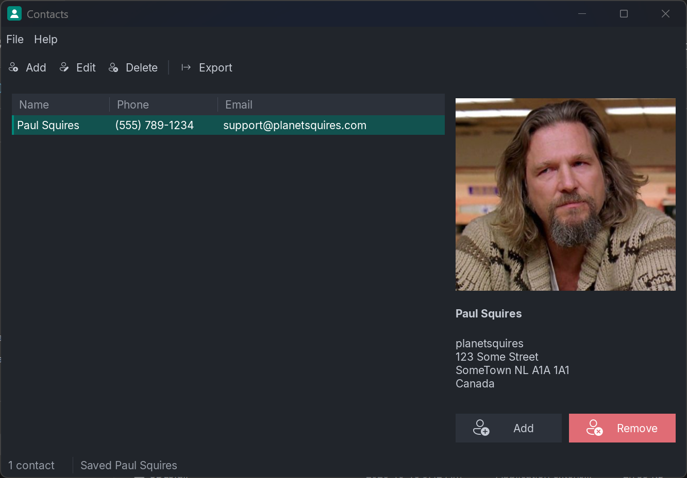

[Home](Home) › [All Categories](Categories) › [tkControls](Category-tkControls) › **Contacts Tutorial**

# Contacts: a Form Designer tutorial

Build a complete address book in tkEdit's [Form Designer](Form-Designer): a main window with a menu, a
toolbar, a status bar, a list of people and their photo, and a dialog with tabs for entering a
contact. The data lives in an SQLite database, and the whole list can be exported as a CSV file.

You draw the windows; you write only the code that does the work. The finished program is in the
toolchain's `examples/tkControls/tkContacts`, so you can compare at any step, or open it in tkEdit
and look around first.

What you'll learn, step by step:

| Feature | Step |
| --- | --- |
| A project and its theme | [2](#2-make-the-project), [3](#3-the-project-theme) |
| The Resource Center, the application icon and the windows' title-bar icons | [4](#4-the-resource-center-and-the-icons) |
| A main menu | [5](#5-the-main-menu) |
| A toolbar | [6](#6-the-toolbar) |
| A status bar | [7](#7-the-status-bar) |
| A list with columns, and how to turn its tooltips off | [8](#8-the-list-of-contacts) |
| A picture control showing a person's photo | [9](#9-the-photo-and-the-address) |
| Buttons with glyphs, one of them in a Danger style | [10](#10-add-and-remove-buttons-with-glyphs) |
| A right-click popup menu | [11](#11-a-right-click-menu) |
| Storing the data with the `vendor/sqlite3` package | [12](#12-the-data-sqlite) |
| A second form, shown as a modal data entry dialog | [13](#13-the-data-entry-form) |
| A tab control: adding controls to its pages, and moving them on and off | [14](#14-tabs-on-the-entry-form) |
| Exporting the data as CSV | [17](#17-export-to-csv) |

## Contents

1. [What you'll build](#1-what-youll-build)
2. [Make the project](#2-make-the-project)
3. [The project theme](#3-the-project-theme)
4. [The Resource Center and the icons](#4-the-resource-center-and-the-icons)
5. [The main menu](#5-the-main-menu)
6. [The toolbar](#6-the-toolbar)
7. [The status bar](#7-the-status-bar)
8. [The list of contacts](#8-the-list-of-contacts)
9. [The photo and the address](#9-the-photo-and-the-address)
10. [Add and Remove buttons with glyphs](#10-add-and-remove-buttons-with-glyphs)
11. [A right-click menu](#11-a-right-click-menu)
12. [The data: SQLite](#12-the-data-sqlite)
13. [The data entry form](#13-the-data-entry-form)
14. [Tabs on the entry form](#14-tabs-on-the-entry-form)
15. [The entry form's code](#15-the-entry-forms-code)
16. [The main window's code](#16-the-main-windows-code)
17. [Export to CSV](#17-export-to-csv)
18. [Run it](#18-run-it)
19. [Troubleshooting](#19-troubleshooting)

---

## 1. What you'll build



From the top: the menu bar (File, Help), the toolbar (Add, Edit, Delete, Export), the list of
contacts with its three columns, and beside it the selected contact's photo, name and address, with
the **Add** and **Remove** buttons under them. The status bar counts the contacts and says what
was last done.

**New Contact...** or **Edit Contact...** opens a dialog with four tabs: **Name**, **Address**,
**Phone & Email** and **Photo**. **OK** saves the contact in the database.

The project ends up like this:

```
tkContacts/
  tiko.toml
  main.tiko                 starts the program
  appTheme/                 the project theme             (step 3)
  appResources/             the Resource Center's files   (step 4)
  appGlyphs/                the glyphs the forms use      (written when you build)
  frmMain/                  the main window               (steps 5 to 11, 16, 17)
  frmContact/               the data entry dialog         (steps 13 to 15)
  contactdb/                the data: SQLite and CSV      (step 12)
  askbox/                   message boxes in the form's fonts (step 16)
```

Each `frmXxx` folder holds three files: the `.tkform` the designer owns, the `.design.tiko` it
generates from it (don't edit it, do commit it), and the `.tiko` with your code.

---

## 2. Make the project

1. In tkEdit, **File > New...**, then **GUI Application...**. Make a folder called `tkContacts`.
2. tkEdit writes the project and opens its first form, `frmMain`, on the design surface. The
   **Toolbox** and the **Properties** panel sit beside it.
3. Click the empty form. The Properties panel shows the form's own settings. Set:

| Property | Value | Why |
| --- | --- | --- |
| **Caption** | `Contacts` | the title bar |
| **Width**, **Height** | `760`, `500` | |
| **StartPosition** | `CenterScreen` | where it first appears |
| **MinWidth**, **MinHeight** | `560`, `380` | the smallest the user can make it |

4. Press **F5**. An empty window called Contacts appears. Close it.

> **Primary** in shortcuts below is Ctrl on Windows and Linux, and Cmd on macOS.

---

## 3. The project theme

Every form in the project shares one theme, `appTheme/appTheme.tktheme`. A new project starts with
the Default theme. Give this one a colour of its own:

1. **Design > Project Theme...** opens the **Theme Center**.
2. On the **Theme** page, set **Name** to `Contacts` and **Accent** to `#00897B` (a teal). The
   preview follows: check marks, the selected row of a list, the focus ring.
3. On the **Fonts and Shape** page, set **Corner radius** to `4`.
4. On the **Styles** page, press **Add**, name the style `Danger`, and set its **Face** row to
   `@Error`. You'll give it to the Remove button in [step 10](#10-add-and-remove-buttons-with-glyphs).
5. **Save**.

The theme file is short:

```toml
format = 1
name = "Contacts"
accent = "#00897B"

[dark]

[light]

[shape]
CornerRadius = 4

[styles.Danger]
Surface = "@Error"
Text = "@SelectedText"
```

The program follows the computer's light or dark setting. The **Preview Light / Dark** command flips
the design surface to check the other one; give it a key in **File > Options > Keyboard Shortcuts**
(**Ctrl+K**). The [Themes Tutorial](Themes-Tutorial) has the rest.

---

## 4. The Resource Center and the icons

The **Resource Center** keeps a project's images and fonts in one place, each under a name. A
property that takes a file then holds `res:` and the name instead of a path, and the file goes into
the program with it.

This program needs two images:

| Name | File | Used for |
| --- | --- | --- |
| `contacts` | `contacts.png`, 256 by 256 | the application icon and the windows' title-bar icon |
| `nophoto` | `nophoto.png` | shown when a contact has no photo |

(Any PNG will do. The ones in `examples/tkControls/tkContacts/appResources/files` are free to copy.)

1. **Design > Resource Center...**
2. Press **+** and pick both files (you can pick several at once). Each is copied into the project's
   `appResources/files/` and named after its file: `contacts` and `nophoto`.
3. Leave **Build into the program** ticked for both: the images go inside the program's file, so it
   needs nothing beside it.
4. Select `contacts` and tick **Application icon (Windows)**. That makes it the program's icon: the
   one Explorer and the taskbar show, and the title-bar icon of every window that has no icon of its
   own. tkEdit writes `appResources/app.ico` and `appResources/app.rc` and adds the `.rc` to
   `tiko.toml`:

```toml
[target.contacts.windows]
resources = ["appResources/app.rc"]
```

5. **Close**.

**A form's own title-bar icon.** Click the empty form, find **Icon** in the Properties panel, press
its **...** and choose `contacts`. The row now says `res:contacts`. You'll do the same for the
second form in [step 13](#13-the-data-entry-form). Linux and macOS programs have no icon inside the
file, so the Application icon changes nothing there; a form's **Icon** still sets its window's icon
wherever the system shows one.

**From code**, a resource is used by the same name anywhere tkControls takes a file:

```freebasic
picPhoto.File = "res:nophoto"
```

`main.tiko` names every resource before the program starts, with the line the new project already has:

```freebasic
appResources.Register( )
```

---

## 5. The main menu

1. In the Toolbox, click **MenuBar**, then click on the form. It docks to the top, and its **Edit
   items** editor opens with a standard menu already in it: File, Edit and Help.
2. Rename it: in the Properties panel set **Name** to `mnuMain`.
3. Make the items look like this. Select an item to change its **Text**, **Shortcut** and
   **Handler**. **Up**, **Down**, **Indent** and **Outdent** move the selected item; **Add** and
   **Remove** add and delete one. Indented items are the drop-down's; a text of `-` is a separator.

| Item | Level | Shortcut | Handler |
| --- | --- | --- | --- |
| File | 0 | | |
| New Contact... | 1 | `Primary+N` | `AddContact` |
| Edit Contact... | 1 | `Primary+E` | `EditContact` |
| Delete Contact | 1 | | `DeleteContact` |
| `-` | 1 | | |
| Export to CSV... | 1 | `Primary+Shift+E` | `ExportCsv` |
| `-` | 1 | | |
| Exit | 1 | | `mnuMain_File_Exit` |
| Help | 0 | | |
| About Contacts | 1 | | `mnuMain_Help_AboutContacts` |

The standard Edit menu isn't needed: remove it and its items.

**Handlers.** Type a name in **Handler** to give an item one. The pencil beside the box makes the
usual name for you (the bar's name and the item's path: `mnuMain_File_Exit`) and takes you to its
code. Here four items get names of their own (`AddContact`, `EditContact`, ...), because the toolbar,
the buttons and the right-click menu will run the very same handlers: one handler, several ways in.

4. **OK**. The empty handlers are added to `frmMain/frmMain.tiko`. Fill in the two simple ones now:

```freebasic
sub Form.mnuMain_File_Exit( )
    this.Close( )
end sub

sub Form.mnuMain_Help_AboutContacts( )
    Ask( "Contacts" & wchr( 10 ) & "Made with tkEdit's Form Designer, tkControls and SQLite.", MBX_ICON_INFO, MBX_BTN_OK )
end sub
```

(`Ask` is a small helper you'll add in [step 16](#16-the-main-windows-code).) **Shift+F7** goes
between the form and its code.

---

## 6. The toolbar

1. Click **Toolbar** in the Toolbox, then the form. It docks under the menu bar, and its editor
   opens with New, Open, Save, a separator, Cut, Copy and Paste.
2. Name it `tbMain`.
3. Change the buttons to these. A toolbar item has a **Kind** (command, toggle or separator), a
   **Text**, a **Glyph** and a **Handler**:

| Text | Kind | Glyph | Handler |
| --- | --- | --- | --- |
| Add | command | `F5C2` (person add) | `AddContact` |
| Edit | command | `E92E` (person edit) | `EditContact` |
| Delete | command | `E92D` (person delete) | `DeleteContact` |
| | separator | | |
| Export | command | `E0C7` (arrow export) | `ExportCsv` |

**Glyphs** are icons drawn from an icon font. They take the theme's colours, follow light and dark,
and stay sharp at any size. The **Glyph** row shows a preview, a box with the glyph's code and a
**...** button:

- Type the code (`F5C2`) in the box: it is a glyph of the bundled Fluent UI System Icons.
- Or press **...** for the **Glyph Picker**: the icon fonts on the left, every glyph of the selected
  one on the right, and a search by code above them.

When you build, tkEdit puts the glyphs your forms use into one small font, `appGlyphs/glyphs.ttf`,
built into the program, and adds `appGlyphs.ApplyOptions( options )` to `main.tiko`.

4. **OK**.

---

## 7. The status bar

1. Place a **StatusBar**. It docks to the bottom. Name it `sbMain`.
2. **Edit items**: two panels.

| Text | Width | Stretch |
| --- | --- | --- |
| `0 contacts` | `140` | |
| `Ready` | | ticked |

**Stretch** gives a panel the space the others leave, so the second panel fills the bar's width.

From code, `tkStatusBar_SetText( sbMain.Handle, index, text )` changes a panel:

```freebasic
sub Form.SetStatus( byref text as const ustring )
    tkStatusBar_SetText( sbMain.Handle, 1, text )
end sub
```

---

## 8. The list of contacts

tkControls' list box is the **ListTree**: a plain list, a list with columns, or a tree.

1. Place a **ListTree** on the left: about `x 12, y 74`, `480` by `388`. Name it `lstContacts`.
2. **Anchor**: tick all four sides (`left top right bottom`). When the window grows, the list grows
   with it.
3. **ShowHeader**: true.
4. **Edit items**: a ListTree's items are its columns.

| Text | Width |
| --- | --- |
| Name | `190` |
| Phone | `120` |
| Email | `180` |

5. Its events, in the event rows of the Properties panel. Type the name to bind one:

| Event | Handler | What it does here |
| --- | --- | --- |
| **SelChange** | `lstContacts_SelChange` | shows the selected contact beside the list |
| **Activate** | `lstContacts_Activate` | a double click or Enter edits the contact |
| **Tooltip** | `lstContacts_Tooltip` | turns the row tooltips off (below) |
| **Message** | `lstContacts_Message` | a right click selects the row (step 11) |

### Turning the tooltips off

When the mouse rests on a row, a ListTree shows a tooltip, and by default that tip is the row's own
text. In a list with columns it only repeats what's already on screen. The **Tooltip** event decides
the tip: the handler is given the row and column, and sets `Text`, which starts empty. A handler
that leaves `Text` empty means **no tooltip**:

```freebasic
' A list shows each row's own text as its tooltip. In a list with columns that tip only repeats
' what is on screen, so this handler leaves Text empty: no tooltips. Set Text to give one.
sub Form.lstContacts_Tooltip( byval row as integer, byval col as integer, byref Text as ustring )
end sub
```

To show something useful instead, set it: `Text = People[row].Notes`. Buttons, toolbars, status
bars and the other controls with a **Tooltip** event work the same way.

### Filling it

Rows are added from code (step 16): `tkListTree_AddString` adds a row and returns its index, and
`tkListTree_SetCellText` fills its other columns.

---

## 9. The photo and the address

To the right of the list:

| Control | Name | Where | Properties |
| --- | --- | --- | --- |
| **Picture** | `picPhoto` | `x 504, y 74`, `244` by `224` | **File**: `res:nophoto` (press **...** and pick it in the Resource Center) |
| **Label** | `lblName` | under the picture, `244` by `24` | **Text** empty, **Font** `UI_BOLD` |
| **Label** | `lblDetails` | under that, `244` by `84` | **Text** empty, **WordWrap** true |

Give all three the **Anchor** `top right`, so they stay beside the list's right edge when the window
is resized.

A Picture shows an image file, a `res:` name, or nothing. Its **Fit** (`Aspect`, the default) keeps
the image's proportions. From code:

```freebasic
' a file on disk; if it isn't there or isn't an image, the placeholder instead
if (len( photo ) = 0) orelse (tkPicture_SetFile( picPhoto.Handle, photo ) = false) then picPhoto.File = "res:nophoto"
```

`picPhoto.File = ...` is the property; `tkPicture_SetFile` is the same call, with a result saying
whether the image loaded. Every control's `.Handle` reaches its whole API this way.

A **WordWrap** label also breaks its text at each line feed, `wchr( 10 )`, which is how the address
gets one line per part.

---

## 10. Add and Remove buttons with glyphs

1. Place two **Buttons** under the labels, `118` by `32`, side by side. Name them `btnAdd` and
   `btnRemove`, with the **Text** `Add` and `Remove`, and **Anchor** `right bottom`.
2. **GlyphLeft**: type `F5C2` (person add) for `btnAdd` and `E92D` (person delete) for
   `btnRemove`. The glyph is drawn before the text.
3. **GlyphSize**: type `16`. **Normal** draws the glyph at the text's size, which is small on a
   button this size; **Large** is a little bigger; a number is a size in points. The button's icon
   box grows to fit it, which is why these buttons are `118` wide: at `108`, Remove's text no
   longer fits and ends in an ellipsis.
4. Bind their **Click** events to the handlers the menu already uses: in the **Click** row type
   `AddContact` for `btnAdd`, and `DeleteContact` for `btnRemove`.
5. Make Remove look risky: select `btnRemove`, click its **Colors** row, set **Style** to `Danger`
   (from [step 3](#3-the-project-theme)) and press **OK**. The button turns the theme's Error colour,
   in light and in dark.

---

## 11. A right-click menu

A **PopupMenu** is a component: it's on the form, but never shown there as a control.

1. Find **PopupMenu** under **Components** in the Toolbox and drop it anywhere on the form. It shows
   as a small box with its name. Name it `mnuContext`.
2. **Edit items**. Its first level is the menu that opens (not a bar):

| Text | Handler |
| --- | --- |
| New Contact... | `AddContact` |
| Edit Contact... | `EditContact` |
| Delete Contact | `DeleteContact` |
| `-` | |
| Export to CSV... | `ExportCsv` |

3. Select `lstContacts` and set its **ContextMenu** row to `mnuContext`.

A right click on the list, the Menu key or Shift+F10 now opens the menu. Any control can have one;
the form's own **ContextMenu** covers every control inside it that has none.

**Selecting the row under the mouse.** A ListTree selects rows with the left button only, so a right
click on a row that isn't selected would open the menu for the wrong contact. The list's **Message**
event sees every mouse and key message before the list does; this handler selects the row first,
then lets the list carry on (it leaves `Handled` false):

```freebasic
' A right click selects the row under the mouse before the right-click menu opens, so the menu's
' Edit and Delete act on that row.
sub Form.lstContacts_Message( byval m as TKLISTTREE_MESSAGEINFO ptr, byref Handled as boolean )
    if (m->msg = TKM_RBUTTONDOWN) andalso (m->idx >= 0) then
        tkListTree_SetCurSel( lstContacts.Handle, m->idx )
        ShowSelected( )
    end if
end sub
```

The menu's **Popup** event, if you bind one, runs just before it opens, the moment to check or
disable its items.

That's the main window drawn. **Alt+F5** (Test Form) shows it with working controls, no handlers
run. Try resizing it: the list stretches, the photo and buttons stay on the right.

---

## 12. The data: SQLite

The forms should never see SQL. Put the data in a module of its own: `contactdb`.

1. Make a folder `contactdb` in the project, and in it a file `contactdb.tiko` (**File > New...**,
   then save it there). A folder holding a `.tiko` file of the same name is a module; a form's code
   imports it as `"../contactdb"`, `main.tiko` as `"./contactdb"`.

2. It starts with the module's name and what it imports:

```freebasic
#module "contactdb"

#import "std/containers"
#import "std/fs"
#import "std/strings"
#import "vendor/sqlite3"
using containers
```

`#import "vendor/sqlite3"` is the whole of SQLite: the toolchain ships it as a **vendor package**.
Every function, type and constant of SQLite's C interface is then callable as SQLite documents it
(`sqlite3_open`, `SQLITE_OK`), the library is linked, and its shared library is copied beside the
program. Nothing goes on the command line. `#import "vendor/sqlite3" link static` builds SQLite into
the program instead. See [Vendor Packages](Vendor-Packages).

3. One type for a person:

```freebasic
public type Contact
    Id as int64                  ' 0 until saved
    FirstName as ustring
    LastName as ustring
    Company as ustring
    Street as ustring
    City as ustring
    Region as ustring
    PostalCode as ustring
    Country as ustring
    Phone as ustring
    Mobile as ustring
    Email as ustring
    Notes as ustring
    Photo as ustring             ' its file name in photos/; "" for none
    declare function FullName( ) as ustring
end type
```

4. Opening the database makes the file and its table the first time:

```freebasic
dim shared as sqlite3 ptr db
dim shared as ustring gFolder

public function OpenData( byref folder as const ustring ) as ustring
    if db then sqlite3_close( db ) : db = nullptr
    gFolder = folder
    fs.CreateDirAll( fs.PathJoin( folder, "photos" ) )
    dim as ustring path = fs.PathJoin( folder, "contacts.db" )
    if sqlite3_open( path, @db ) <> SQLITE_OK then
        dim as ustring e = LastError( )
        sqlite3_close( db ) : db = nullptr
        return e
    end if
    return RunSql( "create table if not exists contact( id integer primary key, " _
        & "first_name text not null default '', last_name text not null default '', " _
        ...
        & "photo text not null default '' )" )
end function
```

`Open` and `Close` are tiko keywords, hence `OpenData` and `CloseData`. Each procedure returns `""`
when it worked, else SQLite's reason, which the form shows to the user.

**Text crosses as UTF-8.** SQLite's `_text` functions take and give UTF-8. A `ustring` passed where
the C function wants a `const char *` is converted for the call; coming back, a `string` holding the
bytes is assigned to a `ustring`, which reads them as UTF-8:

```freebasic
function ColText( byval st as sqlite3_stmt ptr, byval col as int32 ) as ustring
    dim as string bytes
    var p = sqlite3_column_text( st, col )
    if p <> nullptr then bytes = *cast( zstring ptr, p )
    return bytes
end function
```

5. **Saving** inserts a new contact or updates one. Values always go in as **parameters** (`?`),
   never pasted into the SQL text, so a name like *O'Brien* can't break the statement:

```freebasic
public function Save( byref c as Contact ) as ustring
    dim as ustring sql
    if c.Id = 0 then
        sql = "insert into contact( " & COLUMNS & " ) values( ?, ?, ?, ?, ?, ?, ?, ?, ?, ?, ?, ?, ? )"
    else
        sql = "update contact set first_name = ?, last_name = ?, ... photo = ? where id = ?"
    end if
    dim as sqlite3_stmt ptr st
    if sqlite3_prepare_v2( db, sql, -1, @st, nullptr ) <> SQLITE_OK then return LastError( )
    for i as long = 0 to NCOLUMNS - 1
        ' an empty ustring reaches C as a null pointer, which SQLite stores as NULL: bind "" for it
        if len( FieldOf( c, i ) ) then
            sqlite3_bind_text( st, i + 1, FieldOf( c, i ), -1, SQLITE_TRANSIENT )
        else
            sqlite3_bind_text( st, i + 1, "", 0, SQLITE_STATIC )
        end if
    next
    if c.Id then sqlite3_bind_int64( st, NCOLUMNS + 1, c.Id )
    dim as long rc = sqlite3_step( st )
    sqlite3_finalize( st )
    if rc <> SQLITE_DONE then return LastError( )
    if c.Id = 0 then c.Id = sqlite3_last_insert_rowid( db )
    return ""
end function
```

> **Watch for this one.** An empty `ustring` is passed to C as a null pointer, and SQLite stores a
> null pointer as `NULL`, which a `not null` column refuses. Bind `""` for an empty field, as above.

6. The rest follow the same pattern; the finished module has them all:

| Procedure | Does |
| --- | --- |
| `OpenData( folder )`, `CloseData( )` | open (making it if needed) and close the database |
| `LoadAll( list )` | every contact, sorted by last name, into an `Array( of Contact )` |
| `Load( id, c )` | one contact |
| `Save( c )` | insert (a new contact gets its `Id`) or update |
| `Remove( id )` | delete a contact and its photo |
| `SetPhoto( c, file )`, `PhotoPath( c )` | copy a chosen image into `photos/<id>.png`; its full path |
| `ExportCsv( path )` | every contact to a CSV file ([step 17](#17-export-to-csv)) |

The photos are files beside the database, `photos/<id>.<ext>`; the table keeps only the file name.

---

## 13. The data entry form

1. **Design > New Form...** and save it as `frmContact.tkform` in the project folder. tkEdit makes
   the folder `frmContact/` with its three files and opens the new form.
2. Click the empty form and set:

| Property | Value |
| --- | --- |
| **Caption** | `Contact` |
| **Width**, **Height** | `480`, `420` |
| **StartPosition** | `CenterOwner` (centred on the main window) |
| **Icon** | `res:contacts` (press **...**) |

3. Two buttons at the bottom right, on the form itself (not on the tabs you'll add next):

| Name | Text | Where | Other |
| --- | --- | --- | --- |
| `btnOK` | `OK` | `x 284, y 372`, `88` by `32` | **Default** true: an accent border marks it as the main button |
| `btnCancel` | `Cancel` | `x 380, y 372`, `88` by `32` | |

Double-click each button to give it its **Click** handler (`btnOK_Click`, `btnCancel_Click`).

---

## 14. Tabs on the entry form

A contact has too many fields for one page, so the dialog divides them among tabs.

### The tab control and its pages

1. Place a **TabControl**: `x 12, y 12`, `456` by `344`. Name it `tabDetails`. Its editor opens
   with one page, Page1.
2. Make four pages. Each page has a caption and a **Glyph** drawn before it:

| Page | Glyph |
| --- | --- |
| Name | `F5BD` (person) |
| Address | `F4F8` (location) |
| Phone & Email | `E270` (call) |
| Photo | `F488` (image) |

3. **OK**.

### Adding controls to a page

On the design surface, **click a tab** to show its page. Then there are three ways to put a control
on it:

- **Draw it on the page.** Click a control in the Toolbox, then click or drag inside the page. It
  belongs to the page showing.
- **Double-click it in the Toolbox** while the tab control is selected: it goes on the page showing,
  at its default size.
- **Paste** (Primary+V) with the mouse over the page: the copies land there, under the mouse. Draw
  a label and a text box once, copy them (Primary+C), and paste them for the next field.

Fill the pages. Labels at `x 16`, `110` wide; text boxes at `x 132`, `300` wide and `28` high; a row
every `40`:

| Page | Labels and text boxes |
| --- | --- |
| Name | `lblFirstName` / `txtFirstName`, `lblLastName` / `txtLastName`, `lblCompany` / `txtCompany` |
| Address | `lblStreet` / `txtStreet`, `lblCity` / `txtCity`, `lblRegion` ("State / Province") / `txtRegion`, `lblPostalCode` / `txtPostalCode`, `lblCountry` / `txtCountry` |
| Phone & Email | `lblPhone` / `txtPhone`, `lblMobile` / `txtMobile`, `lblEmail` / `txtEmail`, `lblNotes` / `txtNotes` (**Multiline** true, `140` high) |
| Photo | **Picture** `picPhoto` (`200` by `200`, **File** `res:nophoto`); buttons `btnChoosePhoto` ("Choose...", **GlyphLeft** `E71A`) and `btnClearPhoto` ("No photo", **GlyphLeft** `F369`), each with its Click handler |

**Design > Align** and **Make Same Size** line up a selection; **Tab Order** sets the order Tab
moves through the boxes.

### Moving controls on and off a page

Controls aren't stuck where you drew them.

**Onto a page.** Say you drew `txtNotes` on the form, below the tab control, before you had the tab
control at all. Show the **Phone & Email** page, then drag `txtNotes` onto it and let go. tkEdit asks:

> Make txtNotes a child of tabDetails, page 'Phone & Email'?

**Yes** moves it in, keeping it where it is on screen, with its name, properties and handlers. **No**
just moves it, still the form's own, drawn over the tab control. The same question comes when you
drop controls on a Panel, a GroupBox or a ScrollPanel. Drag several selected controls and they move
in together.

**Off a page.** Drag a control from a page and drop it on the form, outside the tab control: it
becomes the form's own control, where you dropped it, without a question. (The OK button you might
have drawn on a page by mistake comes off this way.)

**To another page.** Drag it off onto the form, show the other page, and drag it back on.

Every move is one step of **Undo** (Primary+Z).

> **Why it matters.** A control on a page is shown and hidden with its page. A control that only
> *looks* as if it were on the page, but belongs to the form, stays on screen whichever tab is
> picked. If a control shows on every page, it isn't on any of them: drag it off and back on.

---

## 15. The entry form's code

**Shift+F7** to `frmContact/frmContact.tiko`. The dialog keeps the contact it shows, and two
things about its photo:

```freebasic
#module "frmContact"

#import "vendor/tkControls/tkApp"
#import "vendor/tkControls/tkPicture"
#import "vendor/tkControls/tkMessageBox"
#import "vendor/tkControls/tkFileDialog"
#import "../askbox"
#import "../contactdb"
using tkApp
using tkPicture
using tkMessageBox
using tkFileDialog

public partial type Form
    Person as contactdb.Contact      ' what the dialog shows; after OK, what was typed
    PhotoFile as ustring             ' the photo shown: a file's path, or "" for none
    PhotoChanged as boolean          ' a photo was chosen or removed
    declare sub Edit( byref c as contactdb.Contact )
    declare function Collect( ) as boolean
    declare sub ShowPhoto( )
end type
```

Your file and the generated one are one module, joined by the `partial type`: your fields and
procedures sit beside the controls, and each control is reached by its name. A file's own
`#import` and `using` lines apply to that file only.

**Filling it.** The main window calls `Edit` before showing the dialog:

```freebasic
sub Form.Edit( byref c as contactdb.Contact )
    Person = c
    txtFirstName.Text = c.FirstName
    txtLastName.Text = c.LastName
    ' ... every box the same way ...
    txtNotes.Text = c.Notes
    PhotoFile = contactdb.PhotoPath( c )
    PhotoChanged = false
    ShowPhoto( )
    tabDetails.SelectedIndex = 0
end sub
```

**OK and Cancel.** A modal form ends with `EndModal( code )`; `ShowModal` returns that code.

```freebasic
sub Form.btnOK_Click( )
    if Collect( ) then
        EndModal( 1 )
    else
        tabDetails.SelectedIndex = 0
        askbox.Ask( Handle, "Type a first or a last name.", "Contact", MBX_ICON_INFO, MBX_BTN_OK )
    end if
end sub

sub Form.btnCancel_Click( )
    EndModal( 0 )
end sub
```

`Collect` copies the boxes into `Person` (trimmed) and says whether there is a name.

**The photo.** `tkFileDialog_OpenFile` shows the system's Open dialog and returns the path, or `""`
when cancelled. Its filters are one string, `"Name|patterns|Name|patterns"`:

```freebasic
sub Form.btnChoosePhoto_Click( )
    dim as ustring path = tkFileDialog_OpenFile( tkForm_Host( Handle ), "Images|*.png;*.jpg;*.jpeg;*.bmp|All files|*.*" )
    if len( path ) = 0 then exit sub
    PhotoFile = path
    PhotoChanged = true
    ShowPhoto( )
end sub

sub Form.btnClearPhoto_Click( )
    PhotoFile = ""
    PhotoChanged = true
    ShowPhoto( )
end sub
```

The dialog only remembers the choice. The photo is copied into the database's folder when the main
window saves the contact, after OK.

---

## 16. The main window's code

Back in `frmMain/frmMain.tiko`. The main window keeps the contacts the list shows, and one
data entry dialog:

```freebasic
#module "frmMain"

#import "std/containers"
#import "std/fs"
#import "vendor/tkControls/tkApp"
#import "vendor/tkControls/tkListTree"
#import "vendor/tkControls/tkPicture"
#import "vendor/tkControls/tkStatusBar"
#import "vendor/tkControls/tkMessageBox"
#import "vendor/tkControls/tkFileDialog"
#import "../askbox"
#import "../contactdb"
#import "../frmContact"
using containers
using tkApp
using tkListTree
using tkPicture
using tkStatusBar
using tkMessageBox
using tkFileDialog
using tkHost

' The data entry dialog: built the first time it is shown, then hidden and shown again.
dim shared as frmContact.Form dlgContact

public partial type Form
    DataFolder as ustring                    ' the database's folder: set it before Build, or
                                             ' leave it "" for the user's data folder
    People as Array( of contactdb.Contact )  ' the list's rows, in the same order
    declare sub Reload( byval selectId as int64 = 0 )
    declare function Selected( ) as long
    declare sub ShowSelected( )
    declare sub SetStatus( byref text as const ustring )
    declare function EditInDialog( byref c as contactdb.Contact ) as boolean
    declare function Ask( byref text as const ustring, byval icon as long, byval buttons as long ) as long
end type
```

**Opening the database.** Double-click the empty form for its **Load** handler, and bind **Destroy**
in the form's event rows to close the database when the window goes. The database lives in the
user's data folder (`fs.DataDir( )`: `AppData\Local` on Windows, `~/.local/share` on Linux,
`~/Library/Application Support` on macOS):

```freebasic
sub Form.Form_Load( )
    if len( DataFolder ) = 0 then
        dim as ustring none
        DataFolder = fs.PathJoin( fs.DataDir( ).ValueOr( none ), "tkContacts" )
    end if
    dim as ustring e = contactdb.OpenData( DataFolder )
    if len( e ) then
        SetStatus( "Can't open the database: " & e )
        exit sub
    end if
    Reload( )
end sub

sub Form.Form_Destroy( )
    contactdb.CloseData( )
end sub
```

**Filling the list.** One row per contact, its other columns by `SetCellText`, then the count in
the status bar's first panel:

```freebasic
sub Form.Reload( byval selectId as int64 = 0 )
    dim as ustring e = contactdb.LoadAll( People )
    if len( e ) then SetStatus( e )
    dim as TK_WIDGET ptr h = lstContacts.Handle
    tkListTree_Clear( h )
    dim as long pick = 0
    for i as long = 0 to People.Count( ) - 1
        dim byref as contactdb.Contact c = People[i]
        dim as integer row = tkListTree_AddString( h, c.FullName( ) )
        tkListTree_SetCellText( h, row, 1, c.Phone )
        tkListTree_SetCellText( h, row, 2, c.Email )
        if c.Id = selectId then pick = i
    next
    if People.Count( ) then tkListTree_SetCurSel( h, pick )
    tkStatusBar_SetText( sbMain.Handle, 0, People.Count( ) & iif( People.Count( ) = 1, " contact", " contacts" ) )
    ShowSelected( )
end sub
```

`ShowSelected` puts the selected contact's photo in `picPhoto`, its name in `lblName` and its
address in `lblDetails`; `lstContacts_SelChange` calls it.

**The modal dialog.** This is where the second form comes in. `Build( Handle )` makes it, owned by
the main window, the first time; after that it is shown again as it is. `Edit` fills it, and
`ShowModal( Handle )` shows it and waits: the main window can't be used until the dialog closes.
Afterwards the dialog is hidden, not destroyed, so its `Person` can still be read:

```freebasic
function Form.EditInDialog( byref c as contactdb.Contact ) as boolean
    if dlgContact.IsOpen( ) = false then dlgContact.Build( Handle )
    dlgContact.Edit( c )
    if dlgContact.ShowModal( Handle ) <> 1 then return false
    c = dlgContact.Person
    dim as ustring e = contactdb.Save( c )                   ' a new contact gets its id here
    if (len( e ) = 0) andalso dlgContact.PhotoChanged then
        e = contactdb.SetPhoto( c, dlgContact.PhotoFile )   ' the photo is named by the id
        if len( e ) = 0 then e = contactdb.Save( c )
    end if
    if len( e ) then
        Ask( e, MBX_ICON_ERROR, MBX_BTN_OK )
        return false
    end if
    return true
end function
```

**The shared handlers.** The menu items, toolbar buttons, right-click items and buttons all named
these, so each is written once:

```freebasic
sub Form.AddContact( )
    dim as contactdb.Contact c
    if EditInDialog( c ) then
        Reload( c.Id )
        SetStatus( "Added " & c.FullName( ) )
    end if
end sub

sub Form.EditContact( )
    dim as long i = Selected( )
    if i < 0 then exit sub
    dim as contactdb.Contact c = People[i]
    if EditInDialog( c ) then
        Reload( c.Id )
        SetStatus( "Saved " & c.FullName( ) )
    end if
end sub

sub Form.DeleteContact( )
    dim as long i = Selected( )
    if i < 0 then exit sub
    dim as contactdb.Contact c = People[i]
    if Ask( "Delete " & c.FullName( ) & "?", MBX_ICON_QUESTION, MBX_BTN_YESNO ) <> MBX_IDYES then exit sub
    ' ... contactdb.Remove( c.Id ), then Reload with a neighbour selected ...
end sub

' A double click or Enter on a row edits it.
sub Form.lstContacts_Activate( byval row as integer )
    EditContact( )
end sub
```

`Ask` shows a message box over the main window and returns the button pressed:

```freebasic
function Form.Ask( byref text as const ustring, byval icon as long, byval buttons as long ) as long
    return askbox.Ask( Handle, text, "Contacts", icon, buttons )
end function
```

### Message boxes in the form's fonts

A message box's icon (the *i* or the *?*) and its close X are glyphs. `tkMessageBox_Show` gives the
box no fonts of its own, so it draws them in the text font, which has no such characters: you get
empty boxes. Give it the form's fonts instead. Both forms use this small module, `askbox/askbox.tiko`:

```freebasic
#module "askbox"

#import "vendor/tkControls/tkApp"
#import "vendor/tkControls/tkMessageBox"
using tkApp
using tkMessageBox
using tkHost

const as long ICON_PT = 32

' A message box over form f, not shown yet.
public function NewBox( byval f as TK_FORM ptr, byref text as const ustring, byref caption as const ustring, _
                        byval icon as long, byval buttons as long ) as TK_WIDGET ptr
    dim as TK_WIDGET ptr box = tkMessageBox_Create( tkForm_Widget( f ) )
    if box = 0 then return 0
    dim as TTF_Font ptr fIcon = IconFont( tkForm_Host( f ) )   ' the glyph font at ICON_PT
    if fIcon then
        dim as long fh = TTF_GetFontHeight( fIcon )
        tkMessageBox_SetIconSize( box, fh, fh )
    end if
    tkMessageBox_ApplyFonts( box, tkForm_Font( f, TKFONT_UI ), fIcon )   ' text, icon
    tkMessageBox_SetCloseGlyphFont( box, tkForm_Font( f, TKFONT_GLYPH ) ) ' the close X
    tkMessageBox_SetCaption( box, caption )
    tkMessageBox_SetText( box, text )
    tkMessageBox_SetIconKind( box, icon )
    tkMessageBox_AddPreset( box, buttons )
    return box
end function

' Show it and wait: the button pressed (MBX_IDOK, MBX_IDYES, ...).
public function Ask( byval f as TK_FORM ptr, byref text as const ustring, byref caption as const ustring, _
                     byval icon as long, byval buttons as long ) as long
    dim as TK_WIDGET ptr box = NewBox( f, text, caption, icon, buttons )
    if box = 0 then return 0
    return tkMessageBox_DoModal( box )
end function
```

`IconFont` opens the glyph font (`tkApp_GlyphFace( )`) at 32 points with `tkHost_OpenFont` the
first time a window asks, and keeps it: the window owns it and rescales it with the window. The
glyphs themselves are there: the font tkEdit builds for the project always carries tkControls' own
icons (the message box's, a menu's check mark, a combo box's arrow) beside the ones your forms use.

---

## 17. Export to CSV

`std/strings` writes CSV: `CsvWriter` takes a stream (an `fs.File`), and `WriteRow` takes one row
as an `Array( of ustring )`. A field holding a comma, a quote or a line break is quoted, a quote
inside is doubled, and the text is written as UTF-8. In `contactdb`:

```freebasic
public function ExportCsv( byref path as const ustring ) as ustring
    dim as Array( of Contact ) list
    dim as ustring e = LoadAll( list )
    if len( e ) then return e
    dim as fs.File f
    if f.Create( path ).IsOk( ) = false then return fs.PathFileName( path ) & ": can't be written"
    dim as strings.CsvWriter w = strings.CsvWriter( f )
    dim as Array( of ustring ) row
    for each h as ustring in strings.Split( "First name,Last name,Company,Street,City,Region,Postal code,Country,Phone,Mobile,Email,Notes", "," )
        row.Push( h )
    next
    w.WriteRow( row )
    for each c as Contact in list
        row.Clear( )
        for i as long = 0 to NCOLUMNS - 2            ' every field but the photo
            row.Push( FieldOf( c, i ) )
        next
        w.WriteRow( row )
    next
    if w.Finish( ).IsOk( ) = false then return fs.PathFileName( path ) & ": can't be written"
    return ""
end function
```

`Finish` reports the first write that failed, if any. In the form, the system's Save dialog asks
where:

```freebasic
sub Form.ExportCsv( )
    dim as ustring path = tkFileDialog_SaveFile( tkForm_Host( Handle ), "CSV files|*.csv|All files|*.*", "contacts.csv" )
    if len( path ) = 0 then exit sub
    if lcase( fs.PathExtension( path ) ) <> ".csv" then path &= ".csv"
    dim as ustring e = contactdb.ExportCsv( path )
    if len( e ) then
        Ask( e, MBX_ICON_ERROR, MBX_BTN_OK )
    else
        SetStatus( "Exported " & People.Count( ) & " contacts to " & fs.PathFileName( path ) )
    end if
end sub
```

The file opens in any spreadsheet program, and `strings.SplitCsv` reads it back.

---

## 18. Run it

Press **F5**. tkEdit saves, writes the generated files, builds the glyph font and runs the program.

- **File > New Contact...** (Primary+N), fill in a name on the first tab, an address on the second,
  pick a photo on the fourth, **OK**. The contact appears in the list, its photo beside it.
- Right-click a row: the popup menu. Double-click it: the dialog again.
- **Export**, then open the CSV in a spreadsheet.
- Close the program and run it again: the contacts are still there.

`main.tiko` ends up as tkEdit wrote it, plus the glyph line added at the first build:

```freebasic
' tkcontacts: starts the program and shows its first form.
#import "vendor/tkControls/tkApp"
#import "./appGlyphs"
#import "./appResources"
#import "./appTheme"
#import "./frmMain"
using tkApp

dim as TKAPP_OPTIONS options
appResources.Register( )
appTheme.ApplyOptions( options )
appGlyphs.ApplyOptions( options )
if tkApp_Init( options ) = false then end 1
appTheme.Install( )
dim as frmMain.Form mainForm
mainForm.Build( )
end tkApp_Run( mainForm.Handle )
```

Everything in the project folder is source and belongs in version control, the generated
`.design.tiko` files, `appGlyphs/glyphs.ttf` and `appResources/app.ico` included: with them the
program builds without tkEdit, `tiko build` in the folder, on Windows, Linux and macOS.

---

## 19. Troubleshooting

| What you see | Why, and what to do |
| --- | --- |
| A control shows on every tab | It belongs to the form, not a page. Drag it off the tab control and back onto the page; answer **Yes**. |
| A glyph shows as an empty box | The code isn't in the font. Pick it in the **Glyph Picker** instead of typing it. |
| A message box's icon and close X are empty boxes | It was given no glyph font: `tkMessageBox_Show` sets none. Use `askbox.Ask` ([step 16](#16-the-main-windows-code)). |
| A button's text ends in "..." | A bigger **GlyphSize** widens the icon box: make the button wider. |
| `'tkform_host' is not declared` | A form's code file needs its own `#import "vendor/tkControls/tkApp"` and `using tkApp`. |
| `'tk_widget' is not declared` | Add `using tkHost` after the controls' `using` lines. |
| `'open' is already declared` | `Open`, `Close` and other tiko keywords can't be procedure names. |
| `NOT NULL constraint failed` | An empty `ustring` was bound as `NULL`. Bind `""` for empty text ([step 12](#12-the-data-sqlite)). |
| Accented names come back wrong | Read SQLite's text into a `string`, then assign it to a `ustring` (`ColText` above). |
| The picture stays blank | The file isn't there or isn't an image: `tkPicture_SetFile` returned false. Fall back to `res:nophoto`. |
| No program icon in Explorer | **Application icon (Windows)** isn't ticked for an image in the Resource Center, or `tiko.toml` lost its `[target.<name>.windows]` resources line. |

## See also

- [Form Designer](Form-Designer): everything the designer does
- [Themes Tutorial](Themes-Tutorial): themes, styles and colours
- [tkForms](tkForms): `Build`, `Show`, `ShowModal`, `EndModal`
- [tkListTree](tkListTree), [tkPicture](tkPicture), [tkTabControl](tkTabControl),
  [tkContextMenu](tkContextMenu), [tkFileDialog](tkFileDialog), [tkMessageBox](tkMessageBox)
- [Vendor Packages](Vendor-Packages): `vendor/sqlite3` and the others
- [SQLite Tutorial](SQLite-Tutorial): SQLite's C interface in more depth
