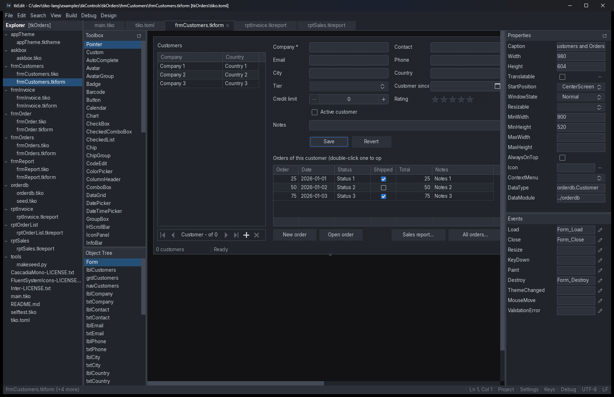
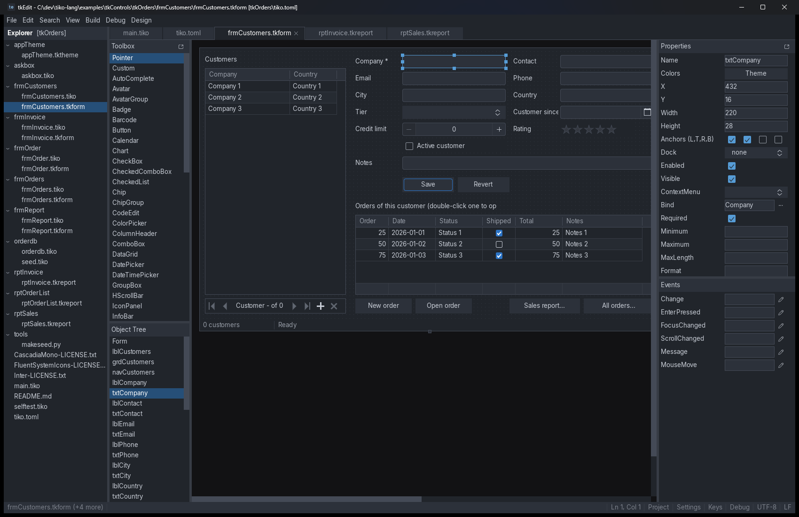
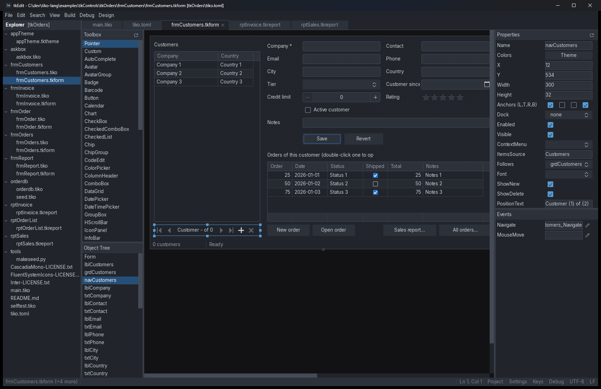
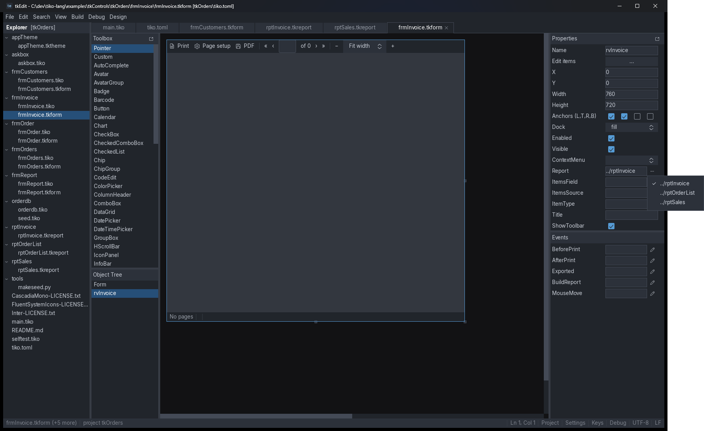

[Home](Home) › [All Categories](Categories) › [tkControls](Category-tkControls) › **Orders Tutorial**

# Orders: a data binding and Report Designer tutorial

Build a customer-and-orders program whose windows are bound to records from an SQLite database, then
print from it with reports drawn in tkEdit's [Report Designer](Report-Designer). You draw the windows
and the reports; tkEdit generates the code that moves the data, and you write only what talks to the
database.

The finished program is in the toolchain's `examples/tkControls/tkOrders`. Open its `tiko.toml` in
tkEdit and look around first, or compare with it at any step. This tutorial explains how it was made.
It assumes you have met the [Form Designer](Form-Designer); the [Contacts Tutorial](Contacts-Tutorial)
covers menus, toolbars, the Resource Center and themes, which this one skips.

What you'll learn, step by step:

| Feature | Step |
| --- | --- |
| Records and SQL in one module of their own | [2](#2-the-data-records-and-sql) |
| A form bound to a record: DataType, Bind, LoadFrom, SaveTo, Required | [3](#3-a-form-bound-to-a-record) |
| A ComboBox's items from a function; DisplayField and ValueField | [4](#4-lists-a-combobox-and-two-datagrids) |
| A DataGrid bound to the form's array, and one bound to a field of the record | [4](#4-lists-a-combobox-and-two-datagrids) |
| A Navigator that follows a list; saving when the user moves on | [5](#5-stepping-through-records-the-navigator) |
| A live grid that edits the record's own array; a method as a column | [6](#6-the-order-dialog-a-live-grid) |
| A DataGrid that is an SQLite query | [7](#7-a-grid-that-is-a-query) |
| How a report gets its data: array, SQLite, DataGrid | [8](#8-reports-where-the-data-comes-from) |
| An invoice: an array source with a child source, a calculated field, a form with a ReportViewer | [9](#9-the-invoice-an-array-and-its-child) |
| Sales by customer: an SQL source, parameters, groups, totals, a conditional style | [10](#10-sales-by-customer-an-sql-query-with-parameters) |
| The order list: printing a DataGrid as the user left it | [11](#11-the-order-list-a-datagrid-as-the-data) |
| Testing reports by their text | [12](#12-testing-it) |

## Contents

1. [What you'll build](#1-what-youll-build)
2. [The data: records and SQL](#2-the-data-records-and-sql)
3. [A form bound to a record](#3-a-form-bound-to-a-record)
4. [Lists: a ComboBox and two DataGrids](#4-lists-a-combobox-and-two-datagrids)
5. [Stepping through records: the Navigator](#5-stepping-through-records-the-navigator)
6. [The order dialog: a live grid](#6-the-order-dialog-a-live-grid)
7. [A grid that is a query](#7-a-grid-that-is-a-query)
8. [Reports: where the data comes from](#8-reports-where-the-data-comes-from)
9. [The invoice: an array and its child](#9-the-invoice-an-array-and-its-child)
10. [Sales by customer: an SQL query with parameters](#10-sales-by-customer-an-sql-query-with-parameters)
11. [The order list: a DataGrid as the data](#11-the-order-list-a-datagrid-as-the-data)
12. [Testing it](#12-testing-it)
13. [Run it](#13-run-it)
14. [Troubleshooting](#14-troubleshooting)

---

## 1. What you'll build


Five windows and three reports:

| Window | What it is |
| --- | --- |
| **frmCustomers** | The main window above. One customer at a time, bound to the boxes on the right; the list and the navigator step through them; the grid below lists the customer's orders. |
| **frmOrder** | One order: its header and a grid of its lines, edited in place. **Invoice...** prints it. |
| **frmOrders** | Every order in one grid read straight from SQLite, with a filter row. **Print list...** prints it. |
| **frmInvoice** | A report viewer showing the invoice. |
| **frmReport** | A report viewer for any report: the sales report and the order list use it. |

| Report | Its data |
| --- | --- |
| **rptInvoice** | one `Order` record and its `Lines` array, from the order dialog |
| **rptSales** | an SQL query over the database, with a date range the user can change |
| **rptOrderList** | the rows of frmOrders' grid, filtered and sorted as the user left it |

The project's folders, one per module:

```
tkOrders/
  tiko.toml                 the project: the orders program and its self-test
  main.tiko                 starts the program
  orderdb/                  the records and every SQL statement (+ seed.tiko, the sample data)
  appTheme/  askbox/        the theme; a message box in the form's fonts
  frmCustomers/ frmOrder/ frmOrders/ frmInvoice/ frmReport/
      frmX.tkform           the design (tkEdit owns it)
      frmX.design.tiko      generated from it: don't edit, do commit
      frmX.tiko             your half of the form
  rptInvoice/ rptSales/ rptOrderList/
      rptX.tkreport         the report (tkEdit owns it)
      rptX.design.tiko      generated from it: don't edit, do commit
```

## 2. The data: records and SQL

Everything the forms bind to is a plain tiko `type` in one module, `orderdb`. The forms never see SQL
for a record: they call procedures here. Keeping the records in a module of their own is what lets
the designer find them. A form names the module (**DataModule** `../orderdb`) and the type
(**DataType** `orderdb.Customer`), and tkEdit reads the type's fields from it.

```freebasic
#module "orderdb"

#import "std/containers" public
#import "std/chrono" public
#import "vendor/sqlite3" public
using containers

public type OrderLine
    Id as int64
    ProductId as int64
    Product as ustring
    Qty as int32
    UnitPrice as float64
    declare function Total( ) as float64     ' Qty * UnitPrice: a method can be a grid column
end type

public type Order
    Id as int64                              ' 0 until saved
    CustomerId as int64
    Customer as ustring                      ' the customer's company, shown
    OrderDate as chrono.LocalDate
    Status as ustring
    Shipped as boolean
    Notes as ustring
    Amount as float64                        ' the stored total
    Lines as Array( of OrderLine )           ' only filled by LoadOrder
    declare function Total( ) as float64
end type

public type Customer
    Id as int64                              ' 0 until saved
    Company as ustring
    Contact as ustring
    Email as ustring
    Phone as ustring
    City as ustring
    Country as ustring
    Tier as ustring
    Active as boolean = true
    CreditLimit as float64
    Since as chrono.LocalDate
    Rating as float64
    Notes as ustring
    Orders as Array( of Order )              ' a summary of each order, no lines
    declare function SameAs( byref o as Customer ) as boolean
    declare sub TrimFields( )
end type

' A ComboBox's choice where the text shown is also the value stored.
public type Choice
    Name as ustring
end type

public function Tiers( ) as Array( of Choice )       ' Standard, Silver, Gold, Platinum
```

Below the types are the procedures the forms call, each returning `""` or SQLite's reason:

| Procedure | What it does |
| --- | --- |
| `OpenData( path )`, `CloseData( )` | open (or make, and fill with the sample data) the database |
| `Connection( )` | the open `sqlite3 ptr`: the reports and the query grid use it |
| `LoadCustomers( list )` | every customer, each with a summary of its orders |
| `SaveCustomer( c )`, `DeleteCustomer( id )` | insert or update one; delete one with its orders |
| `LoadOrder( id, o )`, `SaveOrder( o )` | one order with its lines; write it and its lines back |
| `LoadProducts( list )`, `NewOrder( c )` | the products; a blank order for a customer |
| `ORDERS_QUERY` | the SQL that frmOrders' grid shows |
| `Money( d )` | `1234.5` as `"1234.50"` |

The full module is `examples/tkControls/tkOrders/orderdb/orderdb.tiko`; the
[Contacts Tutorial](Contacts-Tutorial#12-the-data-sqlite) explains the `vendor/sqlite3` calls in
detail. One habit matters for binding: a date column is read into a `chrono.LocalDate`, and a column
with no date becomes `LocalDate.Invalid( )`, which a bound date picker shows as empty.

## 3. A form bound to a record

Make the form (**Design > New Form...**, `frmCustomers`) and draw its labels and boxes. Then click the
empty form and set the two properties that make it a data form:

| Property | Value | Why |
| --- | --- | --- |
| **DataType** | `orderdb.Customer` | the record the form shows |
| **DataModule** | `../orderdb` | where that type is; the form's generated half imports it |



Now select each box and set its **Bind** to a field of the record. Type the name, or press **...**
beside it for the fields of `orderdb.Customer`. Company must not be left empty, so its **Required** is
ticked:



| Control | Kind | Bind | Rules and props |
| --- | --- | --- | --- |
| `txtCompany` | TextBox | `Company` | Required |
| `txtContact`, `txtEmail`, `txtPhone`, `txtCity`, `txtCountry`, `txtNotes` | TextBox | the field of the same name | |
| `cboTier` | ComboBox | `Tier` | Required; its items in [step 4](#4-lists-a-combobox-and-two-datagrids) |
| `dtpSince` | DatePicker | `Since` (a `chrono.LocalDate`) | AllowEmpty |
| `nudCredit` | NumericUpDown | `CreditLimit` (a `float64`) | Range `0,100000`, Increment 500 |
| `rtgRating` | Rating | `Rating` | |
| `chkActive` | CheckBox | `Active` | |

Save the form. Its generated half, `frmCustomers.design.tiko`, now has `LoadFrom`, `SaveTo` and
`IsDirty`, one line per bound control. `LoadFrom( c )` puts a record on screen:

```freebasic
function Form.LoadFrom( byref r as orderdb.Customer ) as boolean
    tkTextBox_SetText( txtCompany.Handle, tkBind_Text( r.Company ) )
    ...
    tkDatePicker_SetDateValue( dtpSince.Handle, tkBind_Date( r.Since ) )
    tkNumericUpDown_SetValue( nudCredit.Handle, tkBind_Float( r.CreditLimit ) )
    tkCheckBox_SetChecked( chkActive.Handle, tkBind_Bool( r.Active ) )
```

`SaveTo( c )` checks every bound control first and writes nothing unless all pass. An empty Company is
refused with a message box, and the box gets a red border until it is typed in. `IsDirty( c )` says
whether any box shows something other than what `c` holds. The conversions come from the field's
type, so the generator never needs to know it: `tkBind_Float` reads an `int32` or a `float64` alike,
and a wrong field name is the compiler's error in the generated file. The table of what each control
moves is in the [Form Designer](Form-Designer#data-binding).

## 4. Lists: a ComboBox and two DataGrids

**The Tier combo.** Its choices come from a function, `orderdb.Tiers( )`, which returns an
`Array( of Choice )`. Set the combo's list properties:

| Property | Value |
| --- | --- |
| **ItemsSource** | `orderdb.Tiers( )`: a call, or any array the form can reach |
| **ItemType** | `orderdb.Choice` |
| **DisplayField** | `Name`: the text each item shows |
| **ValueField** | `Name`: what **Bind** moves |

With a ValueField, the combo binds the chosen item's *value* instead of its index: `LoadFrom` selects
the item whose `Name` is the customer's `Tier`, and `SaveTo` writes the chosen `Name` back. The
generated `cboTier_Fill( )` fills the items; call it once, before the first `LoadFrom`.

**The list of customers.** A DataGrid, `grdCustomers`, with **ItemsSource** `Customers` and
**ItemType** `orderdb.Customer`. `Customers` is a member you add to the form in your half
(`Customers as Array( of orderdb.Customer )`). Its columns, in **Edit items**, each name a **Field**:
`Company`, `Country`. ReadOnly, SelectionUnit Row.

**The customer's orders.** A second DataGrid, `grdOrders`, bound to a field *of the record* rather
than to a list of the form: **ItemsField** `Orders`, **ItemType** `orderdb.Order`. `LoadFrom` fills
it with the customer's orders, so it changes with every customer. Its columns: `Id` (a footer
`count`), `OrderDate`, `Status`, `Shipped` (a check column), `Amount` (a footer `sum`), `Notes`.

A DataGrid column has no number format of its own, so amounts are shown with two decimals by two
events, **CellFormatting** and **SummaryFormatting**:

```freebasic
sub Form.grdOrders_CellFormatting( byval p as TKDATAGRID_FORMATINFO ptr )
    if (p->col = 4) andalso (p->value->kind = TKDG_FLOAT) then p->text = orderdb.Money( p->value->f )
end sub

sub Form.grdOrders_SummaryFormatting( byval col as integer, byval kind as int32, byref v as TKDG_VALUE, byref text as ustring )
    if (col = 4) andalso (v.kind = TKDG_FLOAT) then text = orderdb.Money( v.f )
end sub
```

## 5. Stepping through records: the Navigator

Draw a **Navigator** (in Lists) under the list. Set its **ItemsSource** to `Customers`, the same array
as the list, and its **Follows** to `grdCustomers`. Following ties the two together: a click in the
list moves the navigator, and a navigator move selects the list's row. Its **PositionText** is
`Customer {1} of {2}`.



The generated half now has the navigator's procedures:

| Procedure | What it does |
| --- | --- |
| `navCustomers_Refresh( )` | refills the list, counts the records, shows the current one (or blanks the form) |
| `navCustomers_MoveTo( i )` | what the buttons and a click in the list do. **If the record on show was changed, `SaveTo` writes it into the array first**, and if that refuses, the navigator stays put |
| `navCustomers_Current( )` | the index on show, -1 for none |

New (+) appends a blank record and shows it; Delete (×) removes the one on show. The navigator's
**Navigate** event runs before any of it and can say no.

All of that moves values between the boxes and the **array**. Nothing generated knows about SQLite.
Your half of the form adds the database: it reads `Customers` from it, keeps a copy as the database
has it (`Saved`), and writes back every record that changed:

```freebasic
public partial type Form
    DataFile as ustring                         ' the database; "" for orders.db in the data folder
    Customers as Array( of orderdb.Customer )   ' what the list, the navigator and the boxes show
    Saved as Array( of orderdb.Customer )       ' as the database has them, to see what changed
    ...
end type

sub Form.Form_Load( )
    ...
    orderdb.OpenData( DataFile )
    cboTier_Fill( )                       ' generated: the combo's items
    Reload( )
end sub

sub Form.Reload( byval selectId as int64 = 0 )
    orderdb.LoadCustomers( Customers )
    Saved = Customers
    navCustomers_Refresh( )               ' generated: list filled, count, record shown
    ...
end sub

' The boxes into the record on screen (if changed), then every changed record into the database.
function Form.Commit( ) as boolean
    dim as int32 cur = Current( )
    if (cur >= 0) andalso IsDirty( Customers[cur] ) then
        if SaveTo( Customers[cur] ) = false then return false
        navCustomers_ListRow_( cur )      ' generated: the list's row shows the new values
    end if
    return WriteChanges( )                ' orderdb.SaveCustomer for each record unlike Saved
end function
```

`Commit` runs before every navigator action, after every click in the list, on Save and on Close. So
moving to another customer saves the one you were on, as in a classic data form:

```freebasic
' Before the navigator moves, adds or deletes (the generated code does it after this, if Allow).
sub Form.navCustomers_Navigate( byval action as int32, byval target as int32, byref Allow as boolean )
    if action = TKNAV_DELETE then
        ' ask first, then orderdb.DeleteCustomer( ... ); Allow = false if the user says no
        ...
        exit sub
    end if
    if Commit( ) = false then Allow = false     ' First, Previous, Next, Last, New: save first
end sub

' A click in the list has already moved the navigator (saving the boxes into the record it left).
sub Form.grdCustomers_CurrentCellChanged( byval row as integer, byval col as integer )
    WriteChanges( )
end sub
```

**Revert** is one line: `LoadFrom( Customers[Current( )] )` puts back what the record holds.

## 6. The order dialog: a live grid


frmOrder's **DataType** is `orderdb.Order`. Its header binds like the customer's boxes: `lblCustomer`
(a Label: in only) to `Customer`, `dtpDate` to `OrderDate`, `cboStatus` to `Status` (items from
`orderdb.Statuses( )`), `chkShipped` to `Shipped`, `txtNotes` to `Notes`.

The lines grid, `grdLines`, is different: **ItemsField** `Lines`, **ItemType** `orderdb.OrderLine`,
and **ItemsLive** ticked. A live grid does not copy the array: it reads and writes the record's own
`Lines`. A quantity typed in a cell is in `Ord.Lines` at once, the Delete key removes a line from
it, and the footer sums follow. One column's **Field** is `Total( )`, a *method* of `OrderLine`: it
is shown, and it is read-only.

The caller fills the dialog and reads it back:

```freebasic
public partial type Form
    Ord as orderdb.Order                         ' what the dialog shows; after OK, what was typed
    Products as Array( of orderdb.Product )      ' cboProduct's items (its ItemsSource)
    ...
end type

sub Form.Edit( byref o as orderdb.Order )
    if Products.Count( ) = 0 then orderdb.LoadProducts( Products )
    cboStatus_Fill( )
    cboProduct_Fill( )
    Ord = o
    LoadFrom( Ord )                              ' the live grid binds Ord.Lines itself
end sub

sub Form.btnOK_Click( )
    if SaveTo( Ord ) then EndModal( 1 )          ' (the example also refuses an order with no lines)
end sub
```

In frmCustomers, **New order** and **Open order** show it modally and save the result:

```freebasic
sub Form.EditOrder( byref o as orderdb.Order )
    if dlgOrder.IsOpen( ) = false then dlgOrder.Build( Handle )
    dlgOrder.Edit( o )
    if dlgOrder.ShowModal( Handle ) <> 1 then exit sub
    orderdb.SaveOrder( dlgOrder.Ord )            ' (the example reports an error here)
    orderdb.LoadCustomerOrders( Customers[Current( )].Id, Customers[Current( )].Orders )
    LoadFrom( Customers[Current( )] )            ' the orders grid shows the change
end sub
```

## 7. A grid that is a query


The **All orders** window shows every order, but it does not load them. Its DataGrid, `grdAll`, has
no ItemsSource: its columns are drawn in the designer (with **ShowFilterRow** and footer totals), and
at Load the grid is handed to an SQL query with `vendor/tkControls/tkDataGridSqlite`:

```freebasic
sub Form.Form_Load( )
    ' false: keep the designer's columns; the query's columns fill them in order
    Query = tkDataGridSqlite_Open( grdAll.Handle, orderdb.Connection( ), orderdb.ORDERS_QUERY, false )
end sub
```

The grid reads a block of rows at a time as you scroll. A header click becomes the query's
`ORDER BY`, the filter row a `WHERE` (`Open`, `>100`, `2025-01-01..2025-06-30`, `^Bl`), and the
footer's count and sum `select count / sum` over the same `WHERE`. SQLite does the work; the grid
never holds every row. Each column's kind comes from the table's declared type, which is why
`orders.total` is a stored column rather than an expression.

## 8. Reports: where the data comes from

A report is a `.tkreport` file drawn in the [Report Designer](Report-Designer): bands down the page,
items in the bands, **data sources**, **parameters**. tkEdit generates a module from it with a type,
`Report`, that you use like any other. A data source is a *name* in the report; the program connects
it to real data through a setter the generator writes, one per source kind:

| Source kind | In the `.tkreport` | The program calls | In this program |
| --- | --- | --- | --- |
| `array` | `item_type = "orderdb.Order"` | `r.Set<Source>( rows )` with an `Array( of T )` | the invoice: the order on the dialog |
| `array`, child | `parent`, `relation = "Lines"` | nothing more: the child rows come from the master's `Lines` | the invoice's lines |
| `sqlite` | `sql`, `params` | `r.SetDatabase( db )` | sales by customer |
| `grid` | `grid = "frmOrders.grdAll"` | `r.Set<Source>Grid( hGrid )` | the order list |

Each source lists its **fields** with their kinds (`text`, `int`, `float`, `bool`, `date`, `time`). That
list is a snapshot: when the report is made, the bound data's fields are checked against it, and a
mismatch refuses the report with a message rather than printing wrong data.

Parameters become typed fields of the `Report` (`r.FromDate`), and a viewer shows them in a strip
above the page with a **Run** button. The report is shown with `r.ShowIn( viewer.Handle )`, or
written with `r.ExportPdf( path, errs )`. The `.tkreport` is embedded in the generated module, so
the program needs no file at run time and no designer.

## 9. The invoice: an array and its child


### Make the report

**Design > New Report...**, in a folder `rptInvoice`. In the wizard:

| Wizard field | Value |
| --- | --- |
| title | `Invoice` |
| source, kind | `Orders`, `array` |
| item_type | `orderdb.Order` |
| fields | `Id:int, Customer, OrderDate:date, Status, Shipped:bool, Notes` |
| layout | `columnar` |
| paper | `A4` |

Set the report's **data_module** to `../orderdb` (click the empty canvas for the report's properties),
so the generated module can name `orderdb.Order`.

### The child source: the order's lines

An order's lines are an `Array( of OrderLine )` *inside* each `Order`. Open **Data sources...** in the
Toolbox, press **+**, and make a second source:

![The Data sources dialog with the sources Orders (array) and Lines (array). Lines is selected: kind array, parent Orders, relation Lines, item_type orderdb.OrderLine, sort [Product].](Orders-Tutorial-designer-sources.png)

| Property | Value | |
| --- | --- | --- |
| name | `Lines` | |
| kind | `array` | |
| parent | `Orders` | it is a child: its rows belong to one order |
| relation | `Lines` | the master's field that holds them |
| item_type | `orderdb.OrderLine` | |
| sort | `[Product]` | the lines print in product order, whatever order they are in |

Its fields are `Product`, `Qty:int` and `UnitPrice:float`.

A line's amount is not a field of `OrderLine` (`Total( )` is a method, and a report reads fields). It
is a **calculated field** of the `Lines` source. Open **Calculated fields...** in the Toolbox, press
**+**, and fill it in:

| Property | Value |
| --- | --- |
| source | `Lines` |
| name | `LineTotal` |
| expr | `[Qty] * [UnitPrice]` |

![The Calculated fields dialog: the list on the left holds Lines.LineTotal, with +, -, up and down buttons under it; on the right, source Lines, name LineTotal and expr [Qty] * [UnitPrice]; OK and Cancel.](Orders-Tutorial-designer-calc.png)

The expression is checked as you enter it, against the source's fields and the report's parameters.
`LineTotal` is then listed under **Fields** with the source's own fields and offered in the
expression editor; a band of `Lines` names it `[LineTotal]`, like a field.

### The bands

![The Report Designer with rptInvoice.tkreport: the Toolbox on the left with its + band entries (+ detail_report among them) and Data sources, Parameters, Calculated fields, Group and sort and Page setup, the Fields palette under it (LineTotal listed with the Lines fields), the bands in the middle (report header with the company and INVOICE, the detail band with BILL TO [Customer], Invoice no. [Id], Date [OrderDate], Status and Notes, the detail report with its header row of captions, a detail row [Product] [Qty] [UnitPrice] [LineTotal] and a footer with Total Sum([LineTotal]), and the page footer), and on the right the Object Tree with the [LineTotal] field item selected and its Properties: expr [LineTotal], format #,##0.00, align right.](Orders-Tutorial-designer-report.png)

| Band | Kind | Shows |
| --- | --- | --- |
| `rh` | report_header | the company's name and address, "INVOICE" |
| `d` | detail, source `Orders` | BILL TO `[Customer]`; Invoice no. `[Id]`, Date `[OrderDate]` as `dd/mm/yyyy`, Status; the notes |
| `lines` | detail_report, parent `d`, source `Lines` | the child rows, under the master's detail band |
| `lh` | report_header of `lines` | the captions Product, Qty, Unit price, Amount, a line under them |
| `ld` | detail of `lines` | `[Product]`, `[Qty]`, `[UnitPrice]` and `[LineTotal]` as `#,##0.00` |
| `lf` | report_footer of `lines` | Total `Sum([LineTotal])`: a total in a footer covers what the footer closes, here one order's lines |
| `pf` | page_footer | `Printed {Format(PrintDate, "dd/mm/yyyy")}`, `Page {PageNumber} of {PageCount}` |

The wizard made the top-level bands: a report header, the detail, a report footer and a page footer.
The example renamed them `rh`, `d` and `pf` (click a band's caption; its **id** is in Properties) and
deleted the report footer (Del).

The master-detail bands come from the Toolbox too. Click the detail band's caption, then
**+ detail_report**: it adds a `detail_report` under the selected detail, over the child source of
the detail's source (`Lines`, the child of `Orders`), with its own report header, detail and report
footer inside it. The canvas shows them under the detail band, one step in, and they are edited like
any other band. The example renamed them `lines`, `lh`, `ld` and `lf` and set their heights (22, 18
and 30). With no child source left to show, the entry says so in the status bar.

Click a field in **Fields**, then click in a band: a field placed in a detail band also places its
bold caption in the header band above (hold Shift to place it alone).

Three item settings worth knowing, all in Properties:

- The status is one **field** item whose expression joins two fields:
  `[Status] & iif([Shipped], ", shipped", "")`. Its **rules** (`...` beside the row) add a
  conditional style: `[Status] = "Cancelled"` prints it bold red.
- The notes item has **visible** `[Notes] <> ""`, so an order without notes prints no empty line; with
  **wrap** and **can_grow** a long note takes as many lines as it needs.
- Money uses a **format**: `#,##0.00`.

### The generated module

Save, and tkEdit writes `rptInvoice.design.tiko`. For an array source it writes a setter that hands
the report your array, and the procedures that read a row's fields, one `case` per field of the
snapshot:

```freebasic
public partial type Report
    declare sub SetOrders( byref rows as Array( of orderdb.Order ) )
    declare function ShowIn( byval hViewer as TK_WIDGET ptr ) as boolean
    declare function ExportPdf( byref path as ustring, byref errs as ustring ) as boolean
    ...
end type

private sub Lines_Value_( byval p as any ptr, byval m as int32, byval row as int32, byval f as int32, byref v as TK_VALUE )
    dim byref as Array( of orderdb.Order ) a_ = *cast( Array( of orderdb.Order ) ptr, p )
    dim byref as orderdb.OrderLine r_ = a_[m].Lines[row]     ' master m's line row
    select case f
    case 0 : tkBind_ToValue( r_.Product, @v )
    case 1 : tkBind_ToValue( r_.Qty, @v )
    case 2 : tkBind_ToValue( r_.UnitPrice, @v )
    end select
end sub
```

The report reads the rows from your array as it lays the pages out, without copying them, so the
array must outlive the report's use of it.

### A form to show it in

Make a form, `frmInvoice`, with one **ReportViewer** (in Other), Dock Fill, named `rvInvoice`. A
ReportViewer has a **Report** property that names a report module: the form then gets a member of
that report's type. Its `...` lists the project's reports as the form's folder imports them; pick
`../rptInvoice` (or type it). In the `.tkform` it is the control's `report = "../rptInvoice"`.



Save, and the generated half declares `rvInvoiceReport as rptInvoice.Report`. Your half gives it the
order:

```freebasic
#module "frmInvoice"

#import "std/containers"
#import "../orderdb"
using containers

public partial type Form
    Orders as Array( of orderdb.Order )      ' the report's rows: it reads them, it doesn't copy them
    declare sub ShowOrder( byref o as orderdb.Order )
end type

sub Form.ShowOrder( byref o as orderdb.Order )
    Orders.Clear( )
    Orders.Push( o )
    rvInvoiceReport.SetOrders( Orders )      ' generated from the .tkreport's source Orders
    rvInvoiceReport.ShowIn( rvInvoice.Handle )
end sub
```

### The Invoice... button

On the order dialog, **Invoice...** prints the order as the dialog shows it. `SaveTo` into a *copy*
collects the header boxes without touching `Ord`, and the lines are already in the copy (the grid is
live):

```freebasic
sub Form.btnPrint_Click( )
    dim as orderdb.Order o = Ord
    if SaveTo( o ) = false then exit sub
    dim as frmInvoice.Form f
    f.Build( Handle )
    f.ShowOrder( o )
    f.ShowModal( Handle )
end sub
```

(frmOrder imports `../frmInvoice`.) The viewer's toolbar prints it, sets up the page, and writes a PDF.

## 10. Sales by customer: an SQL query with parameters


This report reads the database itself. Make it with the wizard: source `Sales`, kind `sqlite`,
parameters `FromDate:date, ToDate:date`, group_by `Company`, layout `tabular`. The source's **sql**:

```sql
select c.company as Company, c.country as Country, o.id as OrderId, o.order_date as OrderDate,
       o.status as Status, o.total as Total
from orders o join customer c on c.id = o.customer_id
where o.order_date between :FromDate and :ToDate and o.status <> 'Cancelled'
order by c.company, o.order_date, o.id
```

The query's `:FromDate` and `:ToDate` are filled from the report's parameters by the source's
**params**, `{ FromDate = "@FromDate", ToDate = "@ToDate" }`: each is an expression, so a parameter
could also be computed. Values are bound as SQL parameters, never pasted into the text; a date goes
in as `yyyy-mm-dd`, the way the table stores it. The fields are `Company`, `Country`, `OrderId:int`,
`OrderDate:date`, `Status`, `Total:float`, named by the query's `as`. A column's kind comes from its
table's declared type, so name table columns, not expressions.

The parameters, in **Parameters...**: `FromDate` (date, default `#2025-01-01#`, prompt `From`) and
`ToDate` (date, default `#2025-12-31#`, prompt `To`). A parameter becomes a field of the generated
`Report`, so it can't be named after a keyword: the Parameters dialog refuses `To`, and says why.

![The Report Designer with rptSales.tkreport: the report header with the title, the period line and the column captions; the page header with the same captions; the group header [Company] and [Country]; the detail band [OrderId] [OrderDate] [Status] [Total] with the Status item selected; the group footer {Count()} orders and Sum([Total]); the report footer "All customers: {Count()} orders" and Sum([Total]); the page footer; the no_data band. Fields lists Sales with its six fields, then Parameters FromDate and ToDate.](Orders-Tutorial-designer-sales.png)

| Band | Kind | Shows |
| --- | --- | --- |
| `rh` | report_header | the title; `Orders from {Format(@FromDate, "dd/mm/yyyy")} to {Format(@ToDate, "dd/mm/yyyy")}`; the column captions |
| `ph` | page_header, **print_on_first_page** off | the column captions again, on every page after the first |
| `g1h` | group_header, group `[Company]` | `[Company]`, `[Country]` |
| `d` | detail, source `Sales` | `[OrderId]`, `[OrderDate]`, `[Status]`, `[Total]` |
| `g1f` | group_footer | `{Count()} orders`, `Sum([Total])`: totals in a group footer cover the group |
| `rf` | report_footer | `All customers: {Count()} orders`, `Sum([Total])`: here, the whole report |
| `nd` | no_data | `No orders between these dates.`, printed instead when the query returns nothing |
| `pf` | page_footer | `Page {PageNumber} of {PageCount}` |

The wizard made all of these but the no-data band, which **+ no_data** in the Toolbox adds.

On the first page, the page header prints *above* the report header, so captions in a page header
would sit over the title. Hence the captions are in the report header too, and the page header is
left off the first page.

The status item has a rule, `[Status] = "Open"`, that prints open orders bold amber.

The program hands the report its connection and shows it in the generic report window, a form with
one ReportViewer and no `report` property:

```freebasic
sub Form.btnSalesReport_Click( )
    if Commit( ) = false then exit sub         ' the report reads the database: write the edits first
    dim as rptSales.Report r                   ' declared before the window, so it outlives it
    r.SetDatabase( orderdb.Connection( ) )
    dim as frmReport.Form f
    f.Build( Handle )
    r.ShowIn( f.rvReport.Handle )
    f.ShowModal( Handle )
end sub
```

The viewer's strip shows **From** and **To** as date pickers; change them and press **Run**, and the
query runs again. In code, the parameters are fields: `r.FromDate.wYear = 2026` before `ShowIn`.

frmCustomers imports `../frmReport`, `../rptSales`, and also `vendor/sqlite3` itself: see
[Troubleshooting](#14-troubleshooting).

## 11. The order list: a DataGrid as the data


**Print list...** on the All orders window prints what the grid shows: only the rows its filter row
lets through, in the order its header clicks chose. The report's source is the grid itself:

| Property | Value |
| --- | --- |
| name, kind | `Orders`, `grid` |
| grid | `frmOrders.grdAll`: the designer reads the grid's columns from the form |

A grid source's fields are the grid's *visible* columns in display order, named by their captions,
typed by the column's kind: `Order:float`, `Date:date`, `Customer`, `Country`, `Status`,
`Shipped:bool`, `Total:float`. A DataGrid's number column holds a `float`, even when the database
column was an integer, so `Order` is `float` and its item has the format `0`. The rows are read from
the grid as the report lays out, in view order; the source does not sort.

The report has one text parameter, `Filters`, printed under the title with **visible**
`@Filters <> ""`. The window fills it from the filter row:

```freebasic
sub Form.btnPrintList_Click( )
    dim as rptOrderList.Report r
    r.SetOrdersGrid( grdAll.Handle )
    r.Filters = FilterText( )            ' "Status: Open": each filtered column's caption and text
    dim as frmReport.Form f
    f.Build( Handle )
    r.ShowIn( f.rvReport.Handle )
    f.ShowModal( Handle )
end sub
```

The report is landscape (**landscape** in the report's properties): seven columns fit across.

## 12. Testing it

`selftest.tiko` drives the program without a person: it makes a database in a temp folder, builds the
forms over it, and calls the handlers the way the generated code does. For the reports it makes each
document and reads back every piece of text it draws, then compares that with what SQLite says:

```freebasic
' Every text a report document draws, "|" after each, page by page.
function DocText( byval doc as TK_PRINTDOC ptr ) as string
    dim as string s
    if doc = 0 then return s
    tkPrintDoc_Generate( doc )
    dim as long np = tkPrintDoc_GetPageCount( doc )
    for pg as long = 0 to np - 1
        for i as long = 0 to tkPrintDoc_GetOpCount( doc, pg ) - 1
            dim as TKPRINT_OPINFO oi
            tkPrintDoc_GetOp( doc, pg, i, oi )
            if oi.op = TKREC_TEXT then s &= oi.text & "|"
            if oi.op = TKPRINT_OP_LATE then s &= PrLateText( oi.text, pg, np, doc ) & "|"   ' PageCount
        next
    next
    return s
end function

    ' rptSales over the sample data: every 2025 order that is not cancelled, and their sum
    dim as rptSales.Report r
    r.SetDatabase( orderdb.Connection( ) )
    dim as ustring errs
    dim as string s = DocText( r.CreateDoc( errs ) )
    dim as string w = "from orders where order_date between '2025-01-01' and '2025-12-31' and status <> 'Cancelled'"
    tkTest_Check( "every 2025 order not cancelled, and their sum", _
        instr( s, "|All customers: " & SqlNum( "select count(*) " & w ) & " orders|" _
                  & Thousands( SqlNum( "select sum( total ) " & w ) ) & "|" ) > 0, s )
```

The invoice is checked line by line against the order's array, the order list against the grid's
filter, and the sales report again after its parameters change, and with dates that have no orders
(the no-data band).

## 13. Run it

Open the project's `tiko.toml` in tkEdit and build the `orders` target, or from a shell in the
project's folder:

```
tiko build orders
orders.exe
tiko build selftest
selftest.exe
```

The first start makes `orders.db` in your data folder (`%APPDATA%\tkOrders\` on Windows) with the
sample data: 25 customers, 16 products, 100 orders and 242 order lines, all made up. Delete the file
to start again.

`main.tiko` is the whole start-up:

```freebasic
#import "vendor/tkControls/tkApp"
#import "./appTheme"
#import "./frmCustomers"
using tkApp

dim as TKAPP_OPTIONS options
appTheme.ApplyOptions( options )
if tkApp_Init( options ) = false then end 1
appTheme.Install( )
dim as frmCustomers.Form mainForm
mainForm.Build( )
end tkApp_Run( mainForm.Handle )
```

## 14. Troubleshooting

| Symptom | Cause and fix |
| --- | --- |
| `lld-link: undefined symbol: ...SETDATABASE(SQLITE3*)` (or `TKDATAGRIDSQLITE_OPEN`) | A module that passes an `sqlite3 ptr` sees `sqlite3` only through `orderdb`'s `#import "vendor/sqlite3" public`. Add `#import "vendor/sqlite3"` to that module itself. |
| `parameter 'To': a reserved word of tiko can't name the report's field` when the report is generated | A parameter named in the `.tkreport` text after a keyword (the Parameters dialog refuses one). Rename it (`ToDate`). |
| The viewer says `source 'Orders': field 'Order' is float in the data and int in the report` | The data's kind and the source's field list disagree. A grid's number column is `float`; make the field `float` and give its item a format. |
| A report's column captions print above its title on page 1 | The page header prints before the report header. Repeat the captions in the report header and turn the page header's **print_on_first_page** off. |
| An edit made in the designer doesn't show in the program | The `.tkreport` / `.tkform` is embedded in the generated `.design.tiko`: save in tkEdit (or `tkedit --generate-forms <folder>`), then rebuild. |
| The invoice is empty, or shows another order | The array given to `SetOrders` must outlive the report's use of it: keep it in a member (`Orders` in frmInvoice), not a local of a procedure that has returned. |
| Moving to another customer loses an edit | The navigator saves into the *array*; the database is your half's job. Call `Commit` from the **Navigate** event and the list's **CurrentCellChanged**, as in [step 5](#5-stepping-through-records-the-navigator). |

## See also

- [Form Designer](Form-Designer#data-binding): every bound control, lists, the navigator, validation
- [Report Designer](Report-Designer): the canvas, the palettes, expressions, data sources
- [tkReport](tkReport), [tkReportViewer](tkReportViewer): the engine and the viewer
- [tkDataGrid](tkDataGrid), [tkNavigator](tkNavigator), [tkComboBox](tkComboBox)
- [Contacts Tutorial](Contacts-Tutorial): menus, toolbar, the Resource Center and themes in the designer
- [SQLite Tutorial](SQLite-Tutorial): SQLite's C interface in more depth
